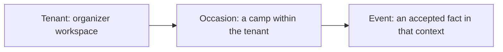
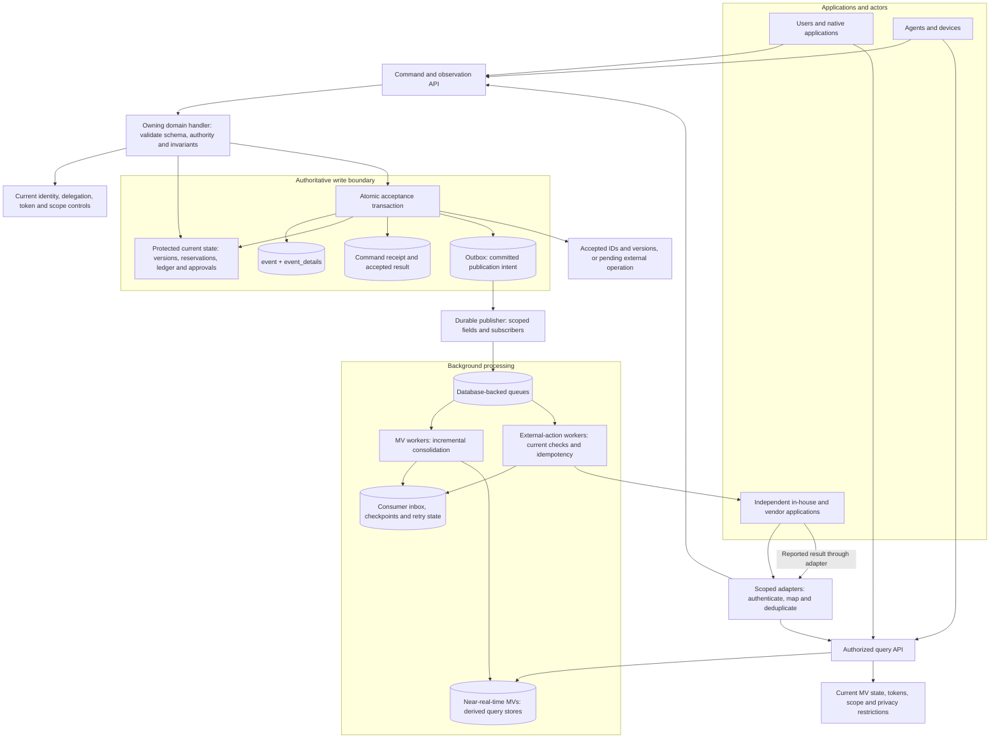
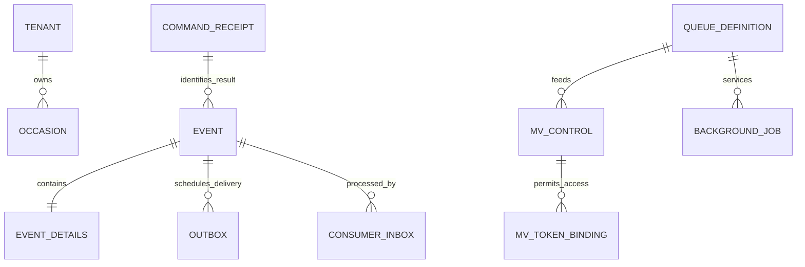
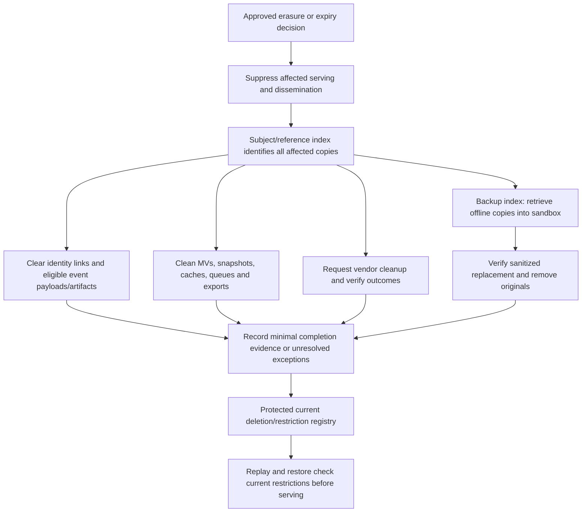

# Architecture

## Application contract and message delivery

The application backend integrates with EP through its API; a future MCP interface may expose the same governed operations. EP creates and validates invitations/authentication challenges and returns the result, including the delivery material the authorized calling backend needs, in that request's API response. For example, TOM requests an invitation or magic-link challenge, receives it and delivers it to the intended recipient through TOM's email/SMS/provider integration. No shared database, filesystem mailbox or EP-specific delivery worker is part of this contract.

EP owns authority checks, tenant/occasion/recipient binding, expiry, revocation, verification/redemption, idempotency and accepted facts. The application backend owns message templates, application URLs, provider credentials, sending and provider retries. The API response is the handoff: recording an invitation/challenge does not mean that a message was delivered. Delivery acknowledgments, delivery queues or a separate notification service are not prerequisites for this request/response flow; any later delivery-status reporting must be an explicit optional API capability.

Delivery material is returned only to the appropriately authorized backend. A magic-link secret is sensitive authentication material: retain only its hash/verification state in EP and keep the raw value out of ordinary events, MVs, logs and unrelated clients. An invitation ID alone remains insufficient for acceptance; the verified intended recipient and current scope/authority rules still apply. Retries/reissuance must have documented API semantics so an uncertain response cannot silently create duplicate invitations or invalidate a challenge being delivered. This boundary preserves the existing recipient verification, rate limits and anti-enumeration requirements; it does not authorize a public browser endpoint to retrieve arbitrary login secrets.

**Implementation status:** Implemented. EP returns delivery material through protected API responses; TOM constructs and delivers the messages. EP delivery workers/mailbox adapters are removed. TOM supports a private development mailbox and configurable SMTP. No delivery-acknowledgment protocol or EP notification queue is required.

## Event Protocol (EP)

The EP provides a shared contract for accepting changes, recording facts and distributing their consequences across native, independently built and third-party applications. It combines an authoritative event history with transactionally protected write state and background-maintained materialized views (MVs). Routine consolidated queries use the MVs; consequential acceptance checks use current protected state.

This design follows [suggested-data-store.md](suggested-data-store.md), [system_1_plan.md](system_1_plan.md), [entity-relationship.md](entity-relationship.md), [finance.md](finance.md) and [gdpr.md](gdpr.md). The diagrams describe logical responsibilities, not a requirement for one deployed service or database per box.

### Scope

Occasion data resolves **tenant > occasion > event** using distinct `tenant_id`, `occasion_id` and `event_id` values. Tenant administration facts have tenant scope without an occasion; signup/global identity facts have explicit global scope. An application binding limits access to tenant-wide or occasion-wide scope, with additional purpose, field and role restrictions.

### Main architecture

The atomic acceptance transaction writes event envelopes/details, command receipts, affected consistency state and outbox records together. The arrows inside that boundary do not represent separate asynchronous writes. Identity/policy state has its own governed updates; handlers enforce the required concurrency/fencing against revocation. Publication begins only after commit.

Workers commit their projection changes and inbox/checkpoint together where they share a transactional store. External effects cannot share a database transaction with a vendor: use stable operation keys, explicit outcomes and reconciliation. A reported vendor success becomes an accepted local fact only after the owning handler validates it.

### Write and query paths

| Path | What it does | Source used |
|---|---|---|
| Command acceptance | Accepts an authorized request and records its consequences | Current policy and consistency state, or a trusted snapshot plus relevant event tail under concurrency protection |
| Event publication | Distributes already committed facts to approved consumers | Durable outbox and permitted integration representation |
| MV maintenance | Incrementally updates affected rows, groups and calculated values | Committed event delivery with ordering, idempotency and checkpoints |
| Normal query | Serves directories, journals, balances, open items, dashboards and other consolidations | Scoped MVs with freshness/generation metadata |
| External action | Sends an invitation, payment instruction or other side effect | Accepted work plus current execution authority and durable operation state |
| Audit/recovery | Explains history or reconstructs supported retained state | Governed event history, schema versions and approved artifacts |

A displayed MV balance or eligibility hint does not authorize posting, settlement, reservation or appointment. Finance uses the EP plus synchronous posting/settlement guards described in [finance.md](finance.md). A read-your-write query can wait for its accepted version with a bounded timeout or show the accepted result while the MV catches up.

### Supporting persistence

`EVENT` in this persistence diagram means the `event` table, not an occasion. Scope fields on each event validate its tenant and, when applicable, occasion. The simplified relations omit global/tenant-only events and do not imply every processing fact needs its own dedicated table.

| Store | Role |
|---|---|
| `event`, `event_details` | Accepted business facts and schema-validated payloads, with minimal personal information |
| Stream heads and domain consistency tables | Protect expected versions, uniqueness, monetary constraints, capacity and other acceptance invariants |
| Dedicated identity and restricted stores | Resolve identities, personal details, credentials and sensitive cases under separate access/lifecycle rules |
| Command receipts, outbox, inbox and checkpoints | Deduplicate acceptance/delivery and recover after crashes without lost work or repeated effects |
| Queue/job definitions and MV controls | Record scope, approved worker settings, MV state, token bindings and erasure windows |
| Query MVs | Rebuildable current/consolidated representations, maintained in background |
| Artifact stores | Versioned documents, invoices, photos, audio and other binaries referenced by ID |
| Privacy and backup indexes | Locate affected subjects/copies and track restriction, erasure, offline retrieval and verified sanitization |

### Administration and failure handling

Tenant admins create queues, configure approved background-job templates and bind MVs to those queues. The initial implementation uses database-backed workers. This provides pub/sub-like fan-out without requiring a separate broker; a future broker can replace delivery infrastructure while preserving the protocol.

MV controls and token validity are current protected state, not asynchronously derived authorization. `stopped` blocks MV serving and ordinary propagation, including access to stale rows. Revoking an assigned token blocks that credential; stopping the MV blocks all its serving paths. Required privacy cleanup runs even when normal work stops, and resume applies pending restrictions/erasures before exposing data.

Failed deliveries retain retry/quarantine state with an owner. Consumers detect stream gaps and duplicate messages. Checkpoints follow safe committed delivery order rather than assuming a sequence-generated ID equals commit order. Each application reports desired/applied revisions and verified external outcomes; one failed vendor cannot silently stall every subscriber.

### Privacy, erasure and safe rebuild

The restriction/deletion registry is updated as soon as the decision requires suppression, not only at final completion. Completion evidence does not substitute for removing eligible personal originals. Retain only justified non-identifying structure or independently justified restricted records. Scheduled erasure windows must respect applicable deadlines; unavailable backups remain tracked unresolved work.

Rebuild into a separate MV generation, apply the current privacy registry, reconcile results and switch readers only after validation. Replay rebuilds representations; it must not resend invitations, execute payments or recreate external invoices. Apply the same suppression before a restored backup can serve users or publish events.

### Protocol guarantees and limits

- An accepted command is atomic within its declared write boundary, with a stable idempotency result and per-stream concurrency checks.
- Delivery is at least once; consumers and external-action workers must tolerate duplicates. There is no claim of universal exactly-once execution across vendors.
- MV freshness is measurable eventual consistency. Event history remains authoritative for event-sourced domains; external accounting/specialist ownership stays explicit.
- Schema versions, source provenance, actual operator and represented identity, scope, causation/correlation, purpose/classification and retention controls travel with the accepted contract as appropriate.
- Native, independent and vendor applications share acceptance/privacy requirements even when their internal storage differs.

## Background reference

[Event-model video recap](https://www.youtube.com/watch?v=W25_BbZCZD0). The diagrams above express this project's documented design; they do not claim to reproduce the video's architecture.

## Implementation status

The [EP application](systems/ep/README.md) implements the first local vertical slice: email magic-link verification and hashed bearer sessions, idempotent tenant creation with first-admin authority, transactional `event`/`event_details`/receipt/outbox state, an Oban-driven local tenant-directory projector and a current-authority-protected MV query. The first local publisher/consumer share one worker transaction; generic external fan-out remains planned.

TOM owns authentication/invitation delivery through its provider or private development mailbox; EP returns material through the API. Occasion creation now adds parent-bound draft state, optional creator occasion-admin authority, scoped events, a separate Oban-driven occasion-directory MV and authorized list/detail endpoints. TOM provides the database-free Rails UI for tenant and occasion creation. Tenant-admin invitations add verified-email acceptance, expiry, revocation and API-returned notification material; grants remain transactional and distinct from participant membership. Occasion-admin invitations now grant only the specified occasion through the same verified-recipient lifecycle, with scoped events and no participant membership or tenant grant. Recruitment now adds explicit opening/closure, published MV-backed intake and pending-only verified-identity applications; current state, expiry and policy checks protect submission independently of MV lag. Workforce admission/safeguarding review, broader policy administration, expiry-review execution, erasure-aware replay and production load validation remain pending. The diagrams above continue to describe the intended broader architecture.

## Monitoring backend contract

EP's initial monitoring contract is documented in [Monitoring API v1](systems/ep/docs/monitoring-api.md).
Registered backend sources bind reporting to an accountable machine identity and immutable
scope. Validated observations/delivery reports and issue actions persist in `event` and
`event_details`; a separate monitoring publication table and Oban queue maintain query MVs
without extending tenant/occasion business streams. Current user authority gates all tenant
and occasion reads/actions. Correlation headers and private accepted-command lookup support
client-side reconciliation and in-context streamed feedback. This is the backend foundation;
TOM now supplies the initial scoped monitoring UI, capture and in-context Turbo feedback;
independent outage collection, alerts and privacy lifecycle automation remain planned in [monitoring_plan.md](monitoring_plan.md).
