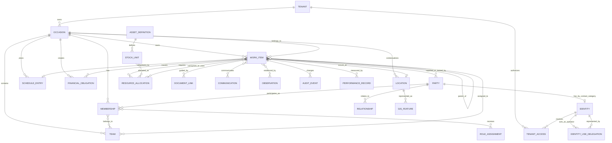

# Core entity/relationship model

This model is derived from the named spaces and, especially, their cross-space relationships in [`named_spaces.md`](named_spaces.md). It is a canonical domain model for shared references and workflows; it is not intended to prescribe one database or one deployment architecture.

**Terminology:** `Tenant` identifies the owning workspace; `Occasion` identifies a camp within it. The hierarchy is tenant > occasion > event. Events record domain facts; `AuditEvent` retains its audit meaning. The datastore uses `event` and `event_details` for recorded facts, as described in [suggested-data-store.md](suggested-data-store.md).

## Design position: `WorkItem` as the operational spine

`Task` is a useful user-facing word, but it is too narrow to be the only core entity. “Replenish toilet-paper in all public restrooms” is a task, while “Spejdernes Lejr 2030” is an occasion within a tenant, not a task. The model therefore uses:

- **`Tenant`** as the owning administrative/isolation boundary and **`Occasion`** as the camp ownership context within it.
- **`WorkItem`** as the common operational unit: something reported, planned, assigned, executed, monitored, or closed.
- **`Task`**, **`ServiceRequest`**, **`Activity`**, and **`Incident`** as typed work items.

This gives the platform one dependable operational backbone without erasing meaningful differences. A routine task can be linked to a facility, stock movement, schedule, team, ticket, or cost. A major incident can coordinate many work items, resources, decisions, communications, and restricted records.

## Entity map



## Canonical entities

### Boundary and participation

| Entity | Meaning | Important relationships |
|---|---|---|
| **`Tenant`** | An administrative/isolation workspace created by an individual or organizational identity. | Owns occasions, tenant access, tenant-wide grants and application bindings; creation atomically grants the creator tenant_admin. |
| **`TenantAccess`** | An identity’s tenant-level access and administrative relationship. | Connects identity and tenant with status, validity and scoped grants; separate from occasion participation. |
| **`Occasion`** | A camp and temporal boundary such as Spejdernes Lejr 2030 within exactly one tenant. | Owns memberships, teams, work items, locations, schedules, configuration, and occasion-scoped financial data. |
| **`Party`** | A canonical human, mechanical/electronic alter-ego, or organization contact. | May be a participant, volunteer, family member, supplier, sponsor, authority, team, or service contact. |
| **`Identity`** | A stable digital principal belonging to exactly one party; required for human/mechanical/electronic parties, optional for organizations. | Has lifecycle, optional sign-in credentials and access grants. An organizational identity may be used by multiple individually authenticated human operators through scoped delegation. |
| **`IdentityUseDelegation`** | A real user’s authority to act through an organizational identity. | Links operator and represented identities, tenant/application/resource scope, allowed actions, validity, issuer, approval and revocation; each action retains both identities. |
| **`Membership`** | An identity-bearing party’s participation in an occasion. | Carries occasion-specific status, participant/volunteer role context, consent references, and links to teams and assignments. |
| **`Team`** | An operational group within an occasion. | Forms a hierarchy; memberships and work assignments can belong to a team and inherit permitted context. |
| **`RoleAssignment`** | A role granted to a membership, party, or operational unit. | Connects role, permission scope, time validity, team, location, and purpose. |
| **`Relationship`** | A typed relationship between parties or between a party and an occasion object. | Covers guardian, family, supplier, sponsor, contact owner, supervisor, and similar relationships, with provenance and validity. |

### Work and participation

| Entity | Meaning | Important relationships |
|---|---|---|
| **`WorkItem`** | The shared lifecycle record for operational work. | Has type, status, priority, severity, owner, assignees, location, schedule, parent/dependencies, resources, communications, evidence, costs, and audit history. |
| **`Task`** | A planned or assigned unit of work. | May be atomic or decomposed into child tasks; can be generated by a plan, inspection, delivery, ticket, incident, or maintenance need. |
| **`ServiceRequest`** | A request for participant support or an operational service. | Usually entered through a ticket; may become one or more tasks or an incident. |
| **`Activity`** | A participant-facing activity or program item. | Has publication, capacity, registration, attendance, staffing, equipment, materials, and feedback. It may create operational tasks. |
| **`Incident`** | A safety, security, environmental, service, or other exceptional event. | Can escalate into incident command, spawn response tasks, trigger communications, restrict visibility, and require post-incident review. |
| **`Participation`** | A membership’s registration for an activity or other occasion offering. | Holds answers, attendance, capacity/waitlist state, consent references, and relevant accessibility/dietary requirements. |
| **`Assignment`** | A person/team’s responsibility for a work item, shift, activity, or operational duty. | Includes responsibility type, supervisor, qualification requirement, validity, and execution status. |

`Ticket` is a presentation and intake concept over `ServiceRequest`, `Task`, or `Incident`; it should not become a second unrelated work hierarchy. A ticket retains its conversation and status history while the underlying work item remains addressable by other systems.

### Place, time, and capacity

| Entity | Meaning | Important relationships |
|---|---|---|
| **`Location`** | A stable semantic place: camp, zone, gate, facility, storage point, kitchen, route segment, or service area. | Belongs to an occasion or shared site model and can be referenced by nearly every operational entity. |
| **`GISFeature`** | The geometric and versioned representation of a location or infrastructure object. | Supports design versions, operational layers, closures, map publication, and map-based dispatch. |
| **`ScheduleEntry`** | A planned or actual time interval. | Represents shifts, activities, deliveries, inspections, maintenance, appointments, and work windows. |
| **`Capacity`** | A constraint or availability statement. | Applies to an activity, location, team, vehicle, asset, facility, channel, or other resource for a time interval. |
| **`Dependency`** | A typed ordering or blocking relationship. | Connects work items, schedule entries, deliveries, approvals, or resource availability. |

### Resources and supply

| Entity | Meaning | Important relationships |
|---|---|---|
| **`Resource`** | A schedulable or consumable capability used by work. | General reference to people, teams, vehicles, facilities, stock, equipment, communication channels, or capacity. |
| **`ResourceAllocation`** | A reservation, issue, consumption, or assignment of a resource. | Links resource, work item, quantity, time, location, status, and releasing/returning party. |
| **`AssetDefinition`** | The type/specification of an asset or consumable. | Has bill-of-materials relationships, reorder data, safety requirements, and accounting classification. |
| **`StockUnit`** | A countable or individually tracked item in stock. | Has location, condition, ownership, serial/lot identity, movements, reservations, maintenance, and occasion availability. |
| **`Movement`** | A physical or logical transfer of stock, people, vehicles, or goods. | Records origin, destination, manifest, time, responsible party, and actual versus planned state. |
| **`SupplierCommitment`** | A procurement, delivery, sponsor contribution, or other external promise. | Connects supplier/sponsor, requirement, goods or services, delivery, cost/funding, and fulfillment status. |

### Evidence, guidance, communication, and money

| Entity | Meaning | Important relationships |
|---|---|---|
| **`Observation`** | A sensor reading, inspection finding, report, or external measurement. | Has timestamp, source, unit, quality, location, threshold context, and may create or update a work item. |
| **`Document`** | A versioned approved artifact such as a procedure, map, form, plan, or training document. | Has owner, review/approval state, effective period, audience, and links to work, roles, locations, and activities. |
| **`Communication`** | A message, alert, broadcast, stream, or conference. | Has sender authority, audience, channel, priority, delivery/acknowledgement status, moderation, and retention policy. |
| **`FinancialObligation`** | A charge, invoice, supplier liability, sponsor commitment, reimbursement, or settlement obligation. | Can be caused by work, procurement, stock loss/damage, participation, or sponsorship. |
| **`Transaction`** | A posted financial movement. | Belongs to an occasion ledger or external funding flow and supports payment accounts, refunds, transfers, reconciliation, and settlement. |
| **`AuditEvent`** | An immutable record of a significant create, change, access, decision, or integration event. | Includes actor, purpose/scope, timestamp, source, object, before/after or decision data, and correlation ID. |
| **`PerformanceRecord`** | A measured result or learning record. | Links outcomes to work, activity, team, resource, or occasion; supports KPIs, quality, safety, cost, satisfaction, and lessons learned. |

## Relationship rules

### The cross-space reference spine

Every occasion-scoped operational object resolves both its tenant and occasion, then these references where applicable:

```text
Tenant > Occasion
 ├─ Party / Identity / Membership / Team / RoleAssignment
 ├─ Location / GISFeature
 ├─ ScheduleEntry / Capacity / Dependency
 ├─ WorkItem
 │   ├─ Assignment / ResourceAllocation
 │   ├─ Document / Communication / Observation
 │   ├─ FinancialObligation
 │   └─ AuditEvent / PerformanceRecord
 └─ external and platform references
```

The references are optional by subtype, but their semantics should be consistent across spaces:

1. **Identity is not contact.** Authentication and authorization refer to `Identity`; business relationships refer to `Party`. Human and mechanical/electronic parties require one identity; organizational parties have zero or one. `IdentityUseDelegation` links real-user operator identities to an organizational identity with scope, validity and audit. The diagram's optional identity cardinality is restricted by these category rules.
2. **Tenant and occasion scoping is explicit.** A party can exist globally; TenantAccess and tenant-wide grants belong to a Tenant. Occasion membership, locations, work, payment accounts and sensitive data resolve both Tenant and Occasion. Occasion permissions cannot leak to sibling occasions; deliberate tenant-wide authority remains explicit.
3. **Location is semantic before geometric.** Operational records reference `Location`; `GISFeature` supplies geometry and versioning. This allows a ticket to survive map redesigns.
4. **Planned and actual are both retained.** Schedules, movements, deliveries, assignments, and attendance must preserve the plan and subsequent observations rather than overwriting history.
5. **Work is composable.** A work item can have parent, child, blocking, and related work items. A service request can become a task; a threshold breach can create an incident; an incident can command a response plan containing tasks.
6. **Resources are allocated, not merely named.** Stock, people, teams, vehicles, facilities, and capacity become operationally meaningful through `ResourceAllocation` with quantity, time, location, and status.
7. **Economic consequences are linked, not inferred.** Damaged stock, sponsor delivery, supplier purchase, participant charge, and labor-like settlement create explicit `FinancialObligation` records linked to their originating work or commitment.
8. **Every consequential change is auditable.** Sensitive access, safety decisions, payment changes, security overrides, workflow transitions, and integration reconciliation produce `AuditEvent` records.

## Core cardinalities

| Relationship | Cardinality | Interpretation |
|---|---:|---|
| `Tenant` → `Occasion` | 1:N | A tenant owns multiple occasions; each occasion has one owning tenant. |
| `Tenant` ↔ `Identity` through `TenantAccess` | M:N | Tenant administration/access is separate from occasion participation. |
| `Occasion` → `Membership` | 1:N | One occasion has many occasion participation records. |
| `Membership` ↔ `Team` | M:N | A participant or volunteer may operate in several teams; team membership may have validity and inheritance rules. |
| `Occasion` → `WorkItem` | 1:N | All operational work is occasion-owned and queryable through one spine. |
| `WorkItem` → child `WorkItem` | 1:N | Work decomposes from program or incident level to atomic execution. |
| `WorkItem` ↔ `Party` / `Team` | M:N | Reporters, owners, assignees, affected parties, supervisors, and responsible teams are distinct relationship roles. |
| `WorkItem` ↔ `Location` | M:N | A work item may span several locations; a location can have many concurrent or historical work items. |
| `WorkItem` ↔ `Resource` | M:N | Allocation carries quantity, time, condition, and release/return state. |
| `WorkItem` ↔ `Document` / `Communication` / `Observation` | M:N | Guidance, evidence, and communication can be reused or linked across work. |
| `WorkItem` → `FinancialObligation` | 1:N | One item may cause several charges, invoices, reimbursements, or settlements. |
| `AssetDefinition` → `StockUnit` | 1:N | A definition may be represented by aggregate stock or individually tracked units. |
| `Observation` → `WorkItem` | 0..N | An observation may create no work, one work item, or several corrective actions. |
| `Activity` → `Participation` | 1:N | Activities have many participant registrations, subject to capacity and eligibility. |
| `Incident` → `Communication` | 0..N | Severity and authority determine whether and how notifications are issued. |

## Suggested implementation boundaries

The model supports separate named-space modules while keeping a small shared kernel:

- **Shared kernel:** `Tenant`, `TenantAccess`, `Occasion`, `Party`, `Identity`, `Membership`, `Team`, `RoleAssignment`, `Location`, `ScheduleEntry`, `WorkItem` identifiers, and `AuditEvent`.
- **Operational modules:** registration/safeguarding, workforce, activities, GIS, logistics/transport, supply/stock, facilities/utilities, monitoring, communications, security, incident command, payments/finance, sponsorship, and knowledge management.
- **Platform services:** integration, search, notifications, workflow, offline reconciliation, data quality, observability, and reporting.

Modules own their detailed records and publish stable references/events. For example, stock owns `StockUnit` and `Movement`; GIS owns `GISFeature`; finance owns `Transaction`; incident command owns operational periods and response decisions. Other modules link to those records rather than copying their authoritative state.

## Example: toilet-paper replenishment

```text
WorkItem(Task: "Replenish toilet-paper in all public restrooms")
 ├─ Occasion: Spejdernes Lejr 2030
 ├─ parent: Facilities operations plan
 ├─ locations: restroom locations / GIS features
 ├─ schedule: recurring inspection and replenishment window
 ├─ assigned_to: sanitation team
 ├─ resource allocations: toilet-paper stock units and vehicle capacity
 ├─ child tasks: pick, transport, replenish, verify
 ├─ observations: low-stock inspection or sensor reading
 ├─ documents: approved sanitation procedure
 ├─ communications: completion or shortage notice
 ├─ financial obligation: only if procurement or supplier replenishment is needed
 └─ performance: response time, stockout rate, and completion quality
```

The same structure scales upward: an `Incident` can be a parent work item with response tasks, while an `Activity` or occasion-wide readiness program can generate thousands of typed tasks. This makes `WorkItem` the practical cross-space integration point without pretending that the occasion itself is a task.

## Invariants and open decisions

The following should be treated as model invariants unless later domain decisions override them:

- Every occasion-scoped record requires a valid `(tenant_id, occasion_id)` pair. Tenant-wide and platform-global records have explicitly different scopes.
- Human/mechanical/electronic parties require exactly one identity; organizational parties may have zero or one, usable by multiple authorized human operators. Identity existence does not require enabled interactive login.
- An identity has at most one `Membership` per occasion, unique on `(tenant_id, occasion_id, identity_id)`; multiple roles, team affiliations and assignments share that membership. Memberships in different occasions have distinct IDs.
- A work item has one lifecycle owner, but can have multiple assignments and collaborating teams.
- A child work item cannot outlive its parent’s occasion scope; closing a parent does not silently close incomplete children.
- A payment account is linked to a participant membership, not permanently to a wristband or reader.
- Sensitive registration, safeguarding, wellbeing, security, and performance data is purpose-limited and separately authorized.
- An approved GIS design is versioned before it becomes operational truth; published map layers are not mutable history.
- Retractions, cancellations, replacements, refunds, and corrections are new records or compensating events, not destructive edits to the original audit trail.
- `Party` and `Identity` are mastered inside this platform. External systems may create or import candidate `Party` records, but they do not become the authoritative owner of the platform’s canonical party identity, merge history, lifecycle, or relationships.
- Every imported or externally created `Party` retains source provenance, source identifiers, import timestamps, field-level confidence or status where needed, and an explicit reconciliation history. Matching and merging must be deliberate and auditable; an import must not silently overwrite participant-provided or stewarded data.
- External sources may include participants’ club or member-management systems, suppliers’ directories or Yellow Pages-style business listings, sponsor and partner systems, public authority registers, and other approved organization services. Each source has a defined trust profile and field-level import policy.
- `Identity` remains platform-owned even when authentication is delegated to an external identity provider. External subject identifiers may be linked as credentials or federation references, but authorization, role assignments, occasion memberships, suspension, and access audit remain platform decisions.
- `WorkItem` state transitions are centrally governed so that lifecycle, audit, authorization, escalation, and reporting remain consistent across modules. Each module may define its own state semantics, transition guards, mandatory data, service levels, and terminal meanings within that shared state-governance framework.
- Closed-loop payments should operate offline where practical, including during connectivity loss. The wristband and reader technology must therefore be challenged to support a cryptographically protected, tamper-evident transaction log with bounded offline balances, replay protection, secure key management, reconciliation, and explicit handling of conflicting or suspicious transactions. “Unbreakable” is not assumed; residual risk, recovery, and operational limits must be defined and tested.
- Incident response requires online access for operational coordination wherever safety permits: signalling first-response teams, triaging, dispatching, escalating, communicating, and maintaining a current shared incident picture. Offline fallback may support local capture and continuity, but it must not be treated as equivalent to confirmed online dispatch or acknowledgement.
- GDPR-aligned retention, access, correction, export, restriction, and deletion rules must be defined and enforced for sensitive records, including registration, health, allergy, safeguarding, emergency-contact, wellbeing, security, and performance data. Retention periods must be purpose-based, documented, auditable, and supported by legal holds or incident-related exceptions where required.
- Trust, matching, field ownership, and reconciliation policies must be in place for every external `Party` source before production import. They must define source authority by field, duplicate detection and merge review, conflict handling, participant-provided data precedence where applicable, correction propagation, withdrawal or deletion handling, and the accountable steward for each decision.

The remaining decisions are primarily implementation and governance details: the approved central transition vocabulary and module-specific state machines; the cryptographic and operational limits for offline payments; the minimum online capabilities and fallback procedures for incident response; the GDPR record schedule and responsible data stewards; and the source-specific policies and tests for external `Party` reconciliation.

## Adopted system 1 control records

`SignupSlug` resolves an authorized tenant/occasion/organization/team context; `Invitation` records inviter, invitee and required lead vouch; `RecoveryVouch` records the higher-authority recovery decision and replacement-channel verification. `ImportReview` represents the yellow list owned by Participant Experience and Programme Lead. These records use restricted event evidence rather than storing authentication secrets.

`ApplicationTenantBinding` includes tenant-wide or occasion-wide access scope. `QueueDefinition`, `BackgroundJobDefinition`, `MVControl` and token bindings support tenant-admin configuration, stopped-state access denial and bounded erasure windows. `Occasion` includes expiry review and mandatory clearance-age policies. `BackupSubjectIndex` tracks all backup generations/dependencies and sandbox removal/replacement outcomes. Current protected state enforces credentials and MV access; query MVs remain derived.
