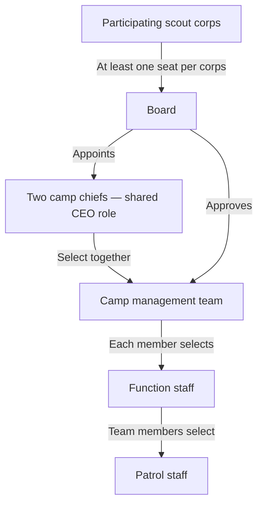

# Spejdernes Lejr 2030 — Planned Organization

This proposal combines the governance structure supplied by the organizers with the responsibilities in [named_spaces.md](named_spaces.md), the systems in [suggested_systems.md](suggested_systems.md), and the shared concepts in [entity-relationship.md](entity-relationship.md). The appointment chain below is a given; the portfolios, working agreements, and controls are recommendations for adoption. “Scout corps” means a participating scout union.

## Tenant and occasion administration

An individual or organizational identity signs up and creates a tenant, becoming its first `tenant_admin` atomically. Tenant admins may add more tenant admins, create occasions, open recruitment, and appoint `occasion_admin` for each occasion. A tenant can host multiple camps, such as SL2026 and SL2030; each camp's data and events use **tenant > occasion > event** scope.

These are platform administrative authorities. The camp Board/chiefs/management appointment chain below remains the business governance of each occasion. Tenant or occasion administration does not by itself constitute Board appointment, chief selection or approval of staff; the applicable workflows retain their decision evidence and restricted-data controls.

## Governance and appointment chain

1. Each participating scout corps has **at least one seat on the Board**. Representation is maintained throughout the occasion lifecycle; additional seats and voting rules follow the agreed governance arrangements.
2. The Board appoints **two camp chiefs who share the CEO role**. They hold joint responsibility for the camp as a whole.
3. The camp chiefs select the **camp management team**, and the Board approves that team.
4. Each camp management team member selects their own **function staff**, within their portfolio's agreed mandate and resources.
5. Function staff team members select their own **patrol staff**, within their function's agreed mandate and resources.

The Board governs purpose, strategic outcomes, overall budget, risk appetite, and accountability. The chiefs direct execution and resolve dependencies between portfolios. Management members own portfolio outcomes; function staff translate those outcomes into services and work plans; patrol staff deliver the work. Routine staffing decisions stay at the level authorized to make them, subject to agreed recruitment, qualification, and safeguarding requirements.

## Shared CEO working agreement

The two chiefs should agree a written division of day-to-day coordination: one coordinates participant experience, people, and external relationships; the other coordinates site delivery, operations, and shared services. These are coordination assignments within one shared CEO role, with every management member reporting to the pair through an identified primary contact.

Both chiefs jointly propose the management team, integrated camp plan, budget, major changes, and Board submissions. For routine decisions, each can act within a recorded delegation. A duty rota identifies the chief available for urgent escalation, with a named alternate. Unresolved disagreements on material decisions go to the Board through an agreed escalation route; the Board must adopt the decision rules, urgency procedure, and financial thresholds before execution begins.

## Recommended camp management portfolios

Use eight outcome-focused portfolios to keep the management team workable while giving every named space a clear accountable owner. A portfolio can contain several functions and systems. The eight seats are a planning baseline: scale function and patrol staffing by workload, geography, qualifications, and operating hours rather than creating a management seat for every system.

System numbers below refer to [suggested_systems.md](suggested_systems.md). An accountable owner sets service outcomes, policy, priorities, and acceptance criteria; technical operation may be provided by the Digital Platform portfolio.

| Management portfolio | Functions whose staff the management member selects | Named spaces owned | Accountable systems |
|---|---|---|---|
| **Participant Experience and Programme** | Registration and participant service; activities and programme; participant-group liaison; inclusion and accessibility | Participant registration and safeguarding (registration service); occasions and activities management | **2** Registration and safeguarding, jointly bounded with Safety below; **5** Ticketing and service management |
| **People and Volunteer Services** | Recruitment and selection support; onboarding and training; workforce planning; volunteer welfare; offboarding | Volunteer and occasion workforce management | **3** Volunteer/workforce management |
| **Site, Facilities and Environment** | Camp design and GIS; construction and commissioning; utilities; maintenance; sanitation and waste; environmental monitoring | GIS-enabled camp planning and operations; facilities and utilities management; environmental and food-safety monitoring (environmental operations) | **7** GIS and digital twin; **15** Facilities and utilities; **9** Environmental and food-safety monitoring (service ownership) |
| **Logistics and Supply** | Procurement; warehouse and assets; arrival and departure; transport and traffic; resource scheduling | Supply-chain management; stock and asset management; arrival and departure logistics; transport and traffic management; calendar, scheduling, and capacity management | **10** Supply chain and procurement; **11** Inventory and assets; **14** Transport and traffic; **18** Scheduling and resource allocation |
| **Food and Retail Services** | Menus and dietary provision; kitchens and meal distribution; kiosks and hospitality; food handling and hygiene | Food-service and catering management | **17** Food service and catering |
| **Safety, Safeguarding and Emergency Readiness** | Safeguarding specialists; emergency planning and response; security and access; safety assurance; food-safety assurance | Emergency and incident command; security, access control, and threat prevention; safeguarding policy and restricted case handling within participant registration; safety standards and assurance within environmental and food-safety monitoring | **6** Emergency and incident command; **16** Security and access control; safeguarding authority in **2** and safety authority in **9** |
| **Finance and Partnerships** | Budget and financial control; accounting and settlement; payment operations; sponsorship and fundraising; external relationship management | Financial and economic planning and execution; closed-loop occasion payments; fundraising and sponsor management; CRM and relationship management | **4** CRM; **12** Closed-loop payments and occasion finance; **13** Billing and accounting integration |
| **Digital Platform, Communications and Knowledge** | Platform and integrations; identity administration; communications service and editorial coordination; knowledge and procedures; reporting and learning | Identity and access; contacts and organizations; occasions and tenancy; memberships and teams; data integration and platform services; closed-loop occasion communications; document, knowledge, and procedure management; performance, learning, and knowledge management | **1** Identity/contact/membership/authorization; **8** Communications; **19** Documents and procedures; **20** Operational intelligence; **21** Integration and platform services |

**Ticketing boundary:** Participant Experience owns the common intake service and service-management process for system 5. Each portfolio owns resolution of tickets assigned to its functions. Safety owns incident classification, restricted handling, and escalation into system 6.

**Safeguarding boundary:** Participant Experience operates registration and consent collection. Safety owns safeguarding policy, specialist evaluation, restricted cases, and clearance decisions. People applies the same clearance requirements to workforce appointments. System 2 has one service owner, with these decision rights recorded explicitly.

**Monitoring boundary:** Site operates system 9 and the environmental monitoring service. Food operates food-handling checks and corrective work. Safety defines safety thresholds, assurance requirements, and stop/resume criteria; designated qualified personnel authorize clearance. Technical administration does not confer access to sensitive case information.

**Scheduling boundary:** Logistics owns the shared scheduling service and conflict-resolution process. People owns workforce availability and welfare constraints; each operating function owns its demand, shifts, and execution. Scheduling conflicts with camp-wide consequences escalate to the chiefs.

**Relationship boundary:** Finance and Partnerships owns the CRM service and sponsor lifecycle. Registration owns participant interactions, Procurement owns supplier relationships, and designated liaisons own authority or scout-corps relationships. All use canonical contacts with explicit relationship owners.

## Functions and patrol delivery

Each function has a charter covering its accountable management member, selecting function staff, purpose, service users, budget, capacity, locations, interfaces, decision limits, deputy arrangements, and escalation path. Each patrol has an identified responsible leader, selecting function staff member, roster, work scope, qualifications, equipment, shifts, procedures, and handover requirements. Staffing volume is determined after demand and coverage planning.

For example, the Logistics and Supply management member selects traffic function staff; those staff select gate, parking, shuttle, and dispatch patrol staff. Site selects utilities function staff, who select installation, inspection, and repair patrol staff. Food selects catering function staff, who select kitchen, distribution, and kiosk patrol staff.

Operational staff patrols are distinct from participants' scout patrols and troop hierarchies. A person may participate in both through separate scoped roles and assignments. Every operational appointment has one recorded line supervisor, even where the person contributes to multiple services.

Cross-portfolio service agreements describe the requesting owner, delivering owner, required outcome, capacity, deadline, acceptance criteria, and escalation path. Temporary readiness groups coordinate dependencies without acquiring a separate staffing hierarchy. For example, kiosk readiness connects Food, Site, Logistics, Finance, Digital, and Safety through one coordinated plan with individually owned tasks.

## Decision rights and controls

| Decision | Decision owner | Required participation or evidence |
|---|---|---|
| Camp purpose, total budget, material risk acceptance | Board | Proposal from both chiefs; recorded Board decision |
| Appointment of both camp chiefs | Board | Recorded appointments and mandate |
| Management-team composition | Chiefs select; Board approves | Proposed responsibilities and approval record |
| Function staff selection | Responsible management member | Workforce checks, agreed capacity, budget, and scoped appointment |
| Patrol staff selection | Responsible function staff team member | Workforce checks, qualifications, supervisor, and scoped assignment |
| Integrated plan and cross-portfolio priorities | Both chiefs, with routine authority delegated explicitly | Management input, dependencies, resource and risk assessment |
| Routine service execution | Function or patrol leader within delegation | Approved procedure, work assignment, resources, and outcome evidence |
| Spending and contracting | Named budget holder within adopted limits | Finance controls; Procurement process; independent approval where required |
| Emergency declaration and operational command | Designated incident authority under an approved response plan | Recorded activation, command appointments, resource assignments, and handover |
| Sensitive-data access or privileged system access | Named data/service authority under policy | Purpose, scope, validity, and audit; appointment alone is insufficient |

Finance should define separation between purchase request, approval, receipt, and payment, and between payment adjustment and reconciliation. Safety must have a direct escalation route to both chiefs and the Board for unresolved serious concerns. Staff must be able to report safeguarding or welfare concerns through a restricted route outside their line supervisor.

During a declared emergency, a designated incident commander coordinates assigned response resources across portfolios under the approved incident plan. This temporary command authority is recorded separately from permanent reporting and appointment authority. The chiefs retain overall executive accountability, and normal service control resumes through a documented handover.

## Organization in the shared occasion platform

- Represent each scout corps as an organization `Party`, and each Board seat as a time-valid representative role linked to that corps. Maintain the minimum representation rule without assuming a voting formula.
- Represent Board, chief office, management portfolios, functions, and operational patrols as occasion-scoped `Team` records in an explicit hierarchy. Record the two chiefs as two people holding the shared executive mandate.
- Use canonical `Party`, `Identity`, `Tenant`, `TenantAccess`, `Occasion`, and occasion `Membership` records. Each identity has one membership per occasion; tenant administration does not require occasion membership. Human and mechanical/electronic contacts require an identity; organizational contacts may have one or none. Multiple real users may use an organizational identity through scoped delegation, retaining actual operator attribution. Add `RoleAssignment` and `Assignment` records for responsibility, supervisor, team, purpose, location, and validity; retain participant-team relationships separately.
- Record who selected each appointee, the appointment's effective dates, and the Board approval for the management team. Appointment and approval history must survive later reorganization.
- Grant permissions through approved role scopes and data policies. Delegated administration cannot grant authority beyond its own scope; hierarchy membership does not automatically expose health, safeguarding, security, or payment records.
- Give each named space and system one recorded accountable service owner, with specialist policy authorities and technical custodians identified separately. Domain owners approve meanings, quality rules, workflows, and access policies; Digital provides common platform capabilities.
- Assign each `WorkItem` one accountable work owner, then link contributing teams, child tasks, dependencies, locations, schedules, resources, costs, and approved procedures. Use common ticket intake and shared references across systems.
- Retain appointment, approval, delegation, access, financial, and incident-command changes as `AuditEvent` records. Publish organization charts, service directories, and escalation contacts from the same current assignments.

This maps business responsibilities to systems without requiring one software deployment per portfolio or one team per namespace.

## Delivery lifecycle and management rhythm

| Phase | Organization priorities | Evidence of readiness or completion |
|---|---|---|
| **Establish** | Confirm Board representation; appoint chiefs; agree executive working rules; select and approve management team | Recorded mandates, approvals, portfolio charters, and service ownership |
| **Plan** | Select function and patrol staff; forecast demand; agree budgets, site plan, programme, interfaces, staffing, and system needs | Integrated plan, named owners, dependency register, workforce and resource forecasts |
| **Prepare and build** | Recruit and train; commission services; rehearse emergency response; test cross-portfolio workflows | Qualifications, coverage, approved procedures, acceptance evidence, unresolved risks with owners |
| **Operate** | Activate duty rosters, service desk, dispatch, incident arrangements, and shift handovers | Live status, acknowledged work, capacity and welfare monitoring, incident and decision records |
| **Dismantle and close** | Return assets; settle obligations; revoke temporary access; capture learning and transfer outstanding work | Reconciliation, returns, access expiry, named residual owners, retention decisions, final report |

During planning, hold regular management reviews of dependencies, budget, staffing, and risks. During build and live operation, use daily coordination and shift handovers, with a duty chief and deputies available whenever services operate. The Board receives milestone and exception reports rather than routine patrol task traffic.

Portfolio dashboards should combine readiness, coverage and workload, service response, safety, participant and volunteer experience, capacity, cost, and delivery quality. Use aggregate reporting for management and purpose-limited access for individual cases. Review lessons at function, portfolio, and camp levels so improvements have an owner for the next occasion.

## Adoption decisions still required

The Board and chiefs should adopt the proposed portfolio boundaries, chief delegation and disagreement rules, spending and risk thresholds, emergency activation powers, and vacancy/deputy procedures. Confirm participating corps and Board representation, then size function and patrol teams using actual attendance, site design, opening hours, workload, and qualification requirements. No specific headcount, personal appointment, vendor choice, voting rule, or legal mandate is assumed by this plan.
