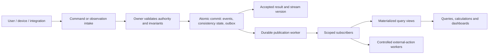

# Suggested Data Store — Governed Events and Materialized Views

## Recommendation and scope

Use a shared event protocol, transactional ingestion, and query projections as the camp's data backbone. Most accepted data-creating or data-changing actions should produce durable, versioned domain events. Queries, dissemination rules, calculations, consolidations, and dashboards should primarily use materialized views, with stronger consistency for validations that protect scarce resources, money, authorization, and safety.

This is a proposed architecture, not a commitment to event-source every system. It combines event sourcing and command/query separation (CQRS) with purpose-specific stores where needed. An event log preserves accepted facts; pub/sub delivers those facts to consumers; background jobs maintain near-real-time materialized views (MVs) for current-state queries and consolidations. These MVs are derived query stores, not the source of truth. These are separate responsibilities, even if initially implemented in one database and application.

The design draws on [domain.md](domain.md), [named_spaces.md](named_spaces.md), [entity-relationship.md](entity-relationship.md), [suggested_systems.md](suggested_systems.md), [organization.md](organization.md), and [prioritized_functions_systems.md](prioritized_functions_systems.md). It preserves their canonical identities, occasion tenancy, WorkItem spine, operational ownership, planned-versus-actual history, restricted information, and offline reconciliation requirements.

## Distinguish occasions, events, and delivery messages

- **Tenant:** The owning administrative/isolation workspace, created by an individual or organizational identity. A tenant can contain multiple occasions.
- **Occasion:** The `Occasion` entity is a camp within one tenant, such as Spejdernes Lejr 2030. Its identifier is distinct from both tenant ID and event ID.
- **Domain event:** An accepted fact about a domain object, such as `FunctionStaffSelected`, `StockReserved`, or `IncidentDeclared`. Use `event` for its persistence table; `event_details` holds its payload.
- **Delivery message:** A transport envelope carrying a domain event or an approved integration representation. Broker delivery and acknowledgement are not evidence that the underlying business action was accepted or completed.

The hierarchy is **tenant > occasion > event**. Occasion-scoped events carry both `tenant_id` and `occasion_id`, plus `event_id`; validate that the occasion belongs to that tenant. Tenant-wide events such as `TenantCreated` and `TenantAdminGranted` carry a tenant but no occasion; signup/global identity events have explicit global scope. Events refer to objects through canonical identifiers. Globally shared parties and identities need an explicitly modeled global scope and controlled sharing; they must not be arbitrarily assigned to one camp or broadcast across tenants.

## Commands, observations, and accepted facts

Users, devices, and external systems submit commands or reported observations. Only the owning domain handler can turn them into authoritative facts after validation. An incoming `ApproveManagementTeam` command is not itself `ManagementTeamApproved`; a temperature report can become `ObservationRecorded` without proving a food-safety incident or granting reopening clearance.

A transaction commits the event envelope and payload together, along with any authoritative consistency state, idempotency result, and publication intent required by that action. Rejection commits no success event; record a purpose-limited command outcome or security audit where appropriate. Distinguish receipt, validation pending, rejection, acceptance, publication, and external completion in APIs and user-visible status.

“Transactional” means an accepted change has an atomic consistency boundary. It does not imply that an entire cross-system workflow, every subscriber update, and an external payment or message delivery occur in one database transaction.

## Core persistence model

A core `event` and `event_details` pair can persist most operational change facts. It cannot by itself provide efficient current-state queries, safe concurrency, reliable delivery, or all specialist storage. PostgreSQL is a reasonable initial implementation candidate because it can combine relational constraints, transactions, and indexed JSONB payloads; capacity and workload must be measured before choosing deployment size or partitioning.

| Store or table | Responsibility | Proposed contents and rules |
|---|---|---|
| `event` | Authoritative event envelope for event-sourced objects | `event_id`, explicit global/tenant/occasion scope, `tenant_id` and `occasion_id` as required by scope, owning namespace, stream type/ID/version, event type/schema version, actor/source, command ID, correlation/causation IDs, occurrence/recording times, classification, and decision-evidence references. Append through approved handlers. |
| `event_details` | Typed event payload | One payload per envelope, keyed by `event_id`, normally a schema-validated JSONB document. Optional immutable artifact/version references. Insert atomically with the envelope. Do not use arbitrary key/value rows as the universal domain model. |
| `stream_head` / consistency tables | Authoritative concurrency and invariant state | Expected/current stream versions; transactionally maintained reservations, capacity counters, access grants, or ledger state where required. Derivable state for event-sourced objects is rebuilt from events under controlled recovery. |
| `command_receipt` | Request deduplication and result tracking | Scope, producer, idempotency key, request fingerprint, command ID, outcome, and accepted event references. Reusing a key with a different request is a conflict. |
| `outbox` | Durable publication intent | Event/delivery reference, destination, eligibility, retry state, and dispatch status. Commit with the domain change; publish after commit. |
| `consumer_inbox` and checkpoints | Reliable subscriber processing | Consumer identity/version, processed event IDs or durable positions, retries, and quarantined failures. Update transactionally with local projection changes where possible. |
| Materialized views / projection tables | Near-real-time, background-maintained query state; never the source of truth | Teams, memberships, work queues, stock availability, capacity, finance summaries, readiness, and incident views, with source versions and projection metadata. Rebuildable where source history remains available. |
| Snapshot store | Optional replay optimization | Stream ID/version, reducer version, and derived state. A snapshot is an optimization; retained events remain authoritative within the supported retention horizon. |
| Restricted and specialist stores | Data with distinct access, retention, or performance requirements | Sensitive personal records, credentials, financial ledger structures, GIS geometry, document/media objects, and raw telemetry. Publish governed references and changes. |

The `event_details` split is useful when payload storage and access differ from envelope storage; otherwise the JSONB payload can live directly on `event`. Two tables are a logical shape, not a requirement to incur a join for every event.

Human and mechanical/electronic contacts require exactly one identity; organizational contacts may have zero or one, usable by multiple authenticated real users through scoped delegation. Identity existence is distinct from interactive sign-in. Enforce these category rules and governed organizational identity retirement in protected state. Enforce membership uniqueness on `(tenant_id, occasion_id, identity_id)` in protected consistency state; multiple roles and team affiliations share that membership, while different occasions have distinct membership IDs. Enforce uniqueness of `(scope_key, stream_type, stream_id, stream_version)` and of accepted command idempotency keys within their defined scope. Use foreign keys and transaction boundaries to preserve envelope/payload integrity. Use a non-null canonical scope key or equivalent scope-aware constraints so nullable global/tenant/occasion fields cannot defeat uniqueness. Validate required canonical references and tenant/occasion ownership at acceptance, including references inside payloads that cannot rely on ordinary foreign keys alone.

Index stream replay, tenant/namespace access, command lookup, and common correlation queries. Put frequent query fields into typed projection columns and use selective JSONB indexes for demonstrated needs. Choose partitioning, snapshots, archival, and telemetry separation from measured workload and retention boundaries rather than assuming one global table remains efficient indefinitely.

## Event protocol and schema governance

Events should express business facts and preserve their meaning over time. Prefer `StockIssued` with quantity, source location, recipient, and work reference to `RecordUpdated` with an unexplained patch. Distinguish proposals, approvals, effective appointments, and revocations instead of treating them as generic status mutations.

| Protocol element | Required meaning |
|---|---|
| Identity and scope | Stable event ID, explicit global/tenant/occasion scope, owning namespace, canonical stream identity, and affected-object references. |
| Type and version | Stable business event name and explicit payload schema version; each type has an owner and validation schema. |
| Ordering and concurrency | Monotonic version within each stream; multi-event transactions have a shared transaction ID and ordinal if consumers need grouping. No camp-wide timestamp ordering assumption. |
| Time | Source occurrence time and server recording time; effective time where different. Late observations preserve both source time and acceptance order. |
| Actor and provenance | Actual authenticated human/machine operator identity, represented identity (including organizational identity), delegation reference, acting membership/role, device/external source and source version. Organizational acting-as must retain the real operator. Actor identifiers can themselves be sensitive. |
| Traceability | Command ID, correlation ID for the workflow, causation reference for the immediate cause, idempotency scope/key or receipt reference. |
| Decision evidence | Purpose/reason, policy version, authority/approval references, and relevant validated stream/state versions. Avoid copying unnecessary sensitive data into evidence. |
| Classification | Audience/security classification, retention category, and permitted integration representation. Envelope metadata must also be protected. |
| Payload | Validated business facts, units/currency where relevant, stable identifiers, and explicit references to immutable artifact versions or restricted records. |

Old events retain their original type and schema. Readers support known historical versions using tested adapters/upcasters; changing business semantics requires a new contract, not a silent reinterpretation. Version projections and their reducers independently, and test mixed-version replay. Corrections are new domain facts such as `StockCountCorrected` with a reason and reference to the affected facts; privacy-driven deletion/redaction follows a separately governed process.

For objects owned by an external accounting or specialist system, the local event records the accepted local action or observed external result and its source version. It does not automatically replace that system's authority.

## Validation and consistency boundaries

Most presentation checks can use query projections. A stale view can suggest available capacity or an eligible volunteer, but acceptance must recheck every invariant that can become false under concurrent changes. A transactionally updated projection can serve as consistency state when it is maintained atomically with the authoritative write and protected by suitable locking or constraints; an asynchronous read model cannot provide that guarantee by itself.

| Validation or use | Appropriate data path | Required safeguard |
|---|---|---|
| Search, dashboards, forecasts, aggregate reports | Asynchronous materialized views | Display freshness and tolerate documented lag; restrict sensitive drill-down. |
| Form hints and preliminary eligibility | Read views | Revalidate consequential conditions when accepting the command. |
| Stock issue, activity capacity, overlapping reservations | Current authoritative stream/consistency state | Transactional constraints, locks or conditional writes across the protected resource set; reject or retry conflicting commands. |
| Payment balance, transfer, refund, settlement | Authoritative ledger and account state | Atomic balanced entries and invariant checks within the financial boundary; a dashboard balance never authorizes spending. |
| Access, appointment authority, safeguarding clearance | Current trusted authority state | Revocations and policy changes participate in an enforced consistency/fencing strategy; stale role projections cannot authorize writes or restricted reads. |
| Emergency command assignment and clearance | Incident authority state plus approved response policy | Validate current command authority; record acknowledgement and clearance explicitly. |
| External effects and cross-module processes | Durable workflow state and accepted events | Explicit pending/completed/failed steps, idempotent execution, and compensating actions where rollback is unavailable. |

For an event-sourced stream, load a trusted snapshot plus subsequent events, or use an equivalent transactionally maintained state, then append with an expected version. Per-stream optimistic concurrency protects that stream; it does not prevent double booking across separate streams unless the shared resource invariant is also protected.

Use atomic multi-object transactions where the objects share a database and ownership boundary. Across independent services, use a durable process manager with reservations and explicit results; avoid presenting an eventually consistent workflow as already complete. Examples include a purchase awaiting budget approval or an activity awaiting confirmed staffing and equipment.

## Materialized views and derived results

The intended design uses **near-real-time, background-maintained materialized views as the normal query path**, including frequently requested consolidations. The accepted events remain the source of truth for event-sourced domains. MVs materialize their consequences so that each query does not repeat history scans, joins, aggregations, and calculations against `event` and `event_details`. They can be corrected or rebuilt from retained source history and versioned calculation logic; editing an MV never constitutes an accepted business change.

Background jobs consume committed changes through the durable publication mechanism, update affected MV rows or aggregates, and advance their processing checkpoints. Prefer incremental updates or bounded recomputation of affected groups over reaggregating the entire event history on every refresh. Workers can batch changes over short intervals to amortize work, with a freshness target agreed for each MV. “Near real time” is a measured lag target, not a claim of synchronous consistency or an assumed fixed latency.

Use MVs for routine lookups, consolidated values, dissemination selection, forecasts, and reporting. Reserve event-history queries for audit, investigation, replay, recovery, and narrowly scoped authoritative validation. This moves consolidation compute from repeated reads to shared background processing; it does not eliminate that compute, and view count, dependency depth, indexing, and update fan-out must remain manageable.

Here **MV describes the logical materialized query store**, independently of its database implementation. It can be an incrementally maintained table, a database-native materialized view, or another derived store. For PostgreSQL native MVs, `REFRESH MATERIALIZED VIEW` replaces the contents using the defining query; `CONCURRENTLY` permits continued reads under documented prerequisites but does not make refresh incremental. Consequently, evaluate native refresh for bounded workloads and use incrementally maintained projection tables where full refresh would defeat the intended compute savings. See [PostgreSQL — REFRESH MATERIALIZED VIEW](https://www.postgresql.org/docs/current/sql-refreshmaterializedview.html).

MV-to-MV consolidation is allowed when its input checkpoints and lineage are recorded. Derived consumers must not interpret partially updated inputs as one coherent camp-wide snapshot. Choose an explicit cutoff or consistent input versions where consolidated results require alignment. Update each MV batch and its checkpoint atomically, expose lag/failure, and rebuild into a separate generation before switching readers to a validated replacement.

MVs support preliminary validation and can supply a starting state for acceptance when their checkpoint is known and any missing relevant events are applied under concurrency protection. Waiting for a worker to catch up alone does not prevent a concurrent conflicting write. The handler must still protect the invariant at commit, using expected stream versions and authoritative resource/ledger/access state as described above. Such write-side consistency state has a different role from the asynchronously maintained query MVs.

Tenant admins bind MVs to queues and configure approved job schedules, source scope, retries and resource limits. MV control records contain lifecycle state and token bindings: `stopped` disables serving/propagation, not merely refresh, and revoked tokens fail current checks. Machine/MV tokens are occasion-admin-issued with manual rotation/revocation; MV data are never authoritative credential state. Approved erasure windows schedule cleanup with immediate serving suppression, deadline enforcement and cleanup independent of stopped ordinary jobs.

Suggested views include `organization_current`, `team_membership_current`, `work_queue`, `activity_capacity`, `workforce_coverage`, `stock_available`, `facility_readiness`, `traffic_status`, `incident_situation`, `payment_summary`, and `camp_readiness`. A person retains one canonical identity while views expose separate participant, volunteer, supervisor, and operational contexts. Planned and actual values are retained separately.

Each projector records its implementation version, processing checkpoint, relevant stream versions, last update time, and failures. Checkpoints must use a publication mechanism with safe committed ordering, such as a correctly managed outbox/CDC feed; a naive `id > last_id` scan over sequence-assigned IDs can miss transactions that commit later with smaller IDs. Per-stream consumers detect gaps or buffer out-of-order messages before applying dependent events.

An accepted command returns event IDs and resulting versions. When a user needs read-your-write behavior, serve accepted state directly or wait for the relevant projection to reach that version with a bounded timeout and explicit pending status. Never hide projection failure behind a permanent successful-looking cached view.

Calculations such as demand forecasts and cost consolidations record their algorithm/version, parameters, source checkpoint or cutoff, and calculation time. Mutable views serve the latest result; approved budgets, clearance decisions, published plans, and other consequential derived results become new governed facts or versioned artifacts. Replaying an accepted decision should not rerun a changed policy and rewrite its historical outcome.

## Publication, subscriptions, and replay

Use at-least-once publication with idempotent processing as the initial contract. The publisher sends only committed events and marks publication progress separately. Subscribers may filter by namespace, tenant, occasion, type, and permitted audience; they do not receive unrestricted access to the core log. Public/participant representations omit sensitive incident or personal detail.

Commit each subscriber's inbox/checkpoint together with its projection updates where possible. Failed events remain visible with retry/quarantine and recovery ownership; silently skipping them can invalidate subsequent state. Reconciliation compares expected events/versions with consumer progress and detects gaps.

Rebuilding a projection must not resend alarms, repeat stock issue instructions, charge payment accounts, or recreate external invoices. Keep side-effect execution separate from projection replay, with stable operation keys and external reconciliation. After a timeout, determine whether an external action completed before retrying it. Commands produced by consumers require their own authorization, deduplication, and causation records to prevent loops.

Tenant admins must be able to create tenant-scoped queues and configure their accompanying background jobs, whether implemented by the initial local worker infrastructure or a broker. A broker is optional for the first implementation: an outbox worker and local consumers can provide the protocol initially. Adopt a dedicated broker when measured fan-out, independent services, delivery latency, or availability justify it. The broker remains a delivery layer; the authoritative database and its backups support durable recovery.

## Coverage of the proposed systems

System numbers match [suggested_systems.md](suggested_systems.md). Portfolio owners and specialist decision rights remain those in [organization.md](organization.md).

| Systems / domain areas | Suitable governed events | Views and additional stores |
|---|---|---|
| **1 — Identity, contacts, memberships and authorization** | Contact established, tenant created/admin granted, occasion created/recruitment opened/admin granted, membership created, role granted/revoked, corps representation recorded, staff selected/appointed. | Canonical directory and organization views; authoritative access state and protected credential provider. |
| **2 — Registration and safeguarding** | Registration submitted/accepted, consent recorded/withdrawn, review requested, clearance granted/revoked. | Registration and eligibility views; restricted guardian, health, and safeguarding records with purpose-specific retention. |
| **3 — Workforce** | Application submitted, selection accepted, training completed, shift assigned, offboarding completed. | Skills, availability and coverage views; restricted welfare and evaluation records. |
| **4 — CRM** | Relationship assigned, interaction recorded, commitment proposed/accepted, sponsor benefit fulfilled. | Relationship and pipeline views; controlled notes/artifact store. |
| **5 — Ticketing and service management; activities namespace** | Work reported, assigned, progressed/resolved; activity proposed/published; participation accepted/cancelled. | Common WorkItem queues, dependency and activity views; authoritative capacity/reservation state. |
| **6 — Emergency and incident command** | Incident declared, command assigned, response requested/acknowledged, clearance recorded, handover completed. | Restricted live situation view and authoritative command state; evidence store. |
| **7 — GIS** | Design version proposed/approved, feature changed, closure activated/lifted. | Spatial database and versioned geometry/artifacts; map projections reference stable Locations. |
| **8 — Communications** | Message authorized, delivery requested, delivered/failed, acknowledgement recorded. | Audience/delivery views; message and media storage; controlled external-action workers. |
| **9 — Monitoring** | Inspection recorded, threshold breach detected, corrective work requested, clearance approved. | Time-series/raw telemetry storage plus condition views; source reading/batch references in domain events. |
| **10–11 — Procurement, inventory and assets** | Request approved, order placed, goods received, stock reserved/issued/returned, damage recorded. | Procurement, stock and readiness views; authoritative stock/reservation constraints and artifact references. |
| **12–13 — Payments, finance and accounting integration** | Financial obligation approved, ledger posting committed, refund posted, external invoice acknowledged, settlement reconciled. | Transactional ledger/account structures; financial query views and accounting-source references. |
| **14–15 — Transport, facilities and utilities** | Movement scheduled/arrived, route closed, facility commissioned, outage reported, maintenance completed. | Traffic, manifest, facility and maintenance views; protected resource state, spatial and inspection references. |
| **16 — Security and access** | Credential issued/revoked/replaced, visitor approved, access attempt recorded, override authorized. | Current authoritative grants and credential state; restricted security views and evidence. |
| **17–18 — Food service and scheduling** | Menu published, meal demand revised, batch prepared, resource booked/released, shift changed. | Dietary-purpose-limited planning views, kitchen schedules, resource calendars; capacity/overlap constraints. |
| **19–20 — Documents, knowledge and intelligence** | Artifact reviewed/approved/published, KPI calculation recorded, lesson accepted, improvement assigned. | Versioned object storage, search indexes, analytics and historical consolidations with lineage. |
| **21 — Integration and platform services** | Import accepted/reconciled/rejected, workflow step completed, synchronization conflict resolved. | Intake provenance, outbox/inbox, workflow state, audit/search infrastructure and operational monitoring. |

## Tenant bootstrap and occasion scope

`CreateTenant` is available to an eligible authenticated signup identity and atomically records tenant creation, TenantAccess and the first `tenant_admin` grant. It does not require preexisting tenant authority. Organizational creators retain actual-operator and represented-identity evidence. Duplicate retries return the same accepted result.

Tenant admins may grant additional tenant-admin access, create occasions, open occasion recruitment and assign occasion admins. `occasion_admin` applies only to its `(tenant_id, occasion_id)` scope; tenant-admin delegation is tenant-wide. Record `TenantCreated`, `TenantAdminGranted`, `OccasionCreated`, `OccasionRecruitmentOpened` and `OccasionAdminGranted` as separately meaningful facts. Opening recruitment governs application intake, not automatic applicant acceptance or participant registration opening.

Tenant-wide and occasion-specific MVs retain their appropriate scope. Event queries, cache keys, subscriber filters and external mappings distinguish tenant from occasion; authorization validates both. Tenant-wide views can consolidate several occasions for authorized users without granting an occasion-only user access to siblings.

## Governance mapped to the appointment chain

Organizational identity use requires a current operator-to-organization delegation. Events and security audits preserve both actual operator and represented identity, rather than presenting shared organizational access as anonymous action. Individual operator revocation does not remove other users' valid access or duplicate the organization's membership.

Board representatives, both camp chiefs, management members, function staff, and patrol staff are canonical parties/memberships with time-valid roles and assignments. The protocol records distinct facts for nomination, selection, approval, appointment, delegation, and termination as required by each workflow.

For management staffing, the chiefs select the proposed team and the Board approves it; operational authority takes effect according to that approval and the appointment's effective dates. Each management member selects their function staff; function staff members select patrol staff within their delegated scope. The service validates selecting authority, qualifications, scope, and mandatory occasion-configured evidence age/expiry/revocation at acceptance. Function leads appoint patrol staff only in their own function and may delegate that bounded authority. Team-tree position alone grants neither appointment power nor access to restricted data.

Digital Platform owns protocol infrastructure, technical access enforcement, schema registration, delivery, and projection recovery. Each domain owner approves event meaning, invariants, service views, retention requirements, and acceptance criteria. Safety owns safeguarding/incident authority and Finance owns financial controls, consistent with the organization document. Audit includes restricted reads, failed access, and policy decisions as well as state changes; business domain events do not replace security-access auditing.

## Restricted data, retention, and tamper evidence

Keep health information, safeguarding narratives, authentication secrets, and unnecessary personal details out of broadly replayable payloads. Use controlled references to restricted records; subscriber access and downstream retention remain explicit. Tenant identifiers, actor references, and object links may still identify people, so protecting only JSON payloads is insufficient.

Append-only history is the normal business rule, not a promise that personal data will be retained forever. Define retention/redaction/deletion processes for source records, event metadata, payloads, replicas, projections, exports, and backups, with explicit treatment of retained obligations and holds. Deleting referenced data reduces future replay fidelity; record that boundary rather than claiming every historical view can always be rebuilt. Encryption and key disposal can support a design but do not alone establish compliance.

Tenant admins set occasion expiry date/duration; crossing it emits one review WorkItem to expire/prolong. Retirement limits reconstructable personal data to eligible opted-in users; other users' content/links become placeholders or are deleted, with narrowly justified legal retention kept restricted. A protected backup-subject index covers every backup and incremental dependency. Retrieve offline copies into an isolated sandbox, sanitize all indexed subject data, verify a replacement and retire/destroy original copies; cleaning only a restored copy is insufficient. Track unavailable/immutable copies as unresolved with custodians and deadlines, and apply suppression before restore or replay serves data.

Limit direct writes, restrict database administration, log privileged actions, and verify backups and restores. Hashes can detect corruption; protection against administrator tampering requires independently protected evidence/checkpoints or another approved mechanism. A normal append-only application API is not by itself a tamper-proof audit system.

## Offline and external ingestion

Offline clients keep a signed or otherwise authenticated source record, stable device/command ID, occurrence time, sequence, and local outcome. On reconnection, intake deduplicates, checks source trust, and either accepts, rejects, or routes conflicts for reconciliation. Local capture does not mean the server accepted a command. Do not use client clocks as authoritative ordering.

Offline payments follow the separately approved bounded protocol, including limits, replay protection, and reconciliation. Emergency dispatch remains online-first: a locally stored observation or message cannot be presented as acknowledged dispatch. External member-service imports preserve source identity and field-level trust/reconciliation instead of silently overwriting canonical contacts.

## Delivery sequence and feasibility checks

Follow [prioritized_functions_systems.md](prioritized_functions_systems.md): build the shared identity and integration foundation in P0, then extend capability through planning and readiness. WorkItem planning, MV/reporting foundations and basic communications now start in P0; shared safeguards precede workforce recruitment. Privacy and application admission are acceptance gates for every consumer.

1. **P0 foundation:** Establish scope/reference rules, schema ownership, command validation, event/payload persistence, expected-version concurrency, idempotency, outbox/inbox, restricted audit, and backup/restore. Pilot the appointment chain and a simple WorkItem lifecycle with current-organization and work-queue projections.
2. **P1 planning:** Add recruitment, registration, planning, procurement, and scheduling workflows. Implement authoritative capacity/reservation checks before accepting scarce-resource commitments. Integrate existing accounting, identity, and document services using the same protocol.
3. **P2 operational preparation:** Add stock, facilities, food, traffic, security, communications, monitoring, and incident workflows. Rehearse cross-portfolio processes, hardware interfaces, payment reconciliation, projection recovery, and controlled external effects.
4. **P3 readiness:** Complete integrated dashboards, duty views, realistic throughput and lag measurements, failover/recovery rehearsals, retention procedures, and operational ownership of failed subscriptions and residual obligations.

Acceptance should demonstrate that concurrent claims cannot overspend or overbook; duplicate commands and deliveries do not duplicate effects; crashes between commit and publication recover; out-of-order/late events converge correctly; revoked authority cannot accept consequential actions; tenant boundaries remain enforced; mixed-version replay reproduces expected views; and rebuilds do not repeat external actions. Exercise privacy-driven source removal, backup restore, offline conflicts, and online dispatch acknowledgement separately.

The main tradeoff is additional engineering for schema evolution, projections, recovery, and invariant enforcement in return for traceable decisions and reusable integration history. Begin with a modular transactional application and database plus projection workers, and split infrastructure when workload or ownership requires it. Confirm expected transaction/telemetry volumes, peak concurrency, latency/freshness targets, availability and recovery targets, retention, external-source authority, and team operating capacity before choosing concrete products and deployment topology.

## Technical references

These sources support the underlying patterns; the camp-specific design and ownership choices above are recommendations derived from the local documents.

- [Microsoft Architecture Center — Event Sourcing](https://learn.microsoft.com/en-us/azure/architecture/patterns/event-sourcing): event-store authority, replay, schema evolution, and implementation tradeoffs.
- [Microsoft Architecture Center — CQRS](https://learn.microsoft.com/en-us/azure/architecture/patterns/cqrs): separate command and query responsibilities and read-model consistency.
- [PostgreSQL — REFRESH MATERIALIZED VIEW](https://www.postgresql.org/docs/current/sql-refreshmaterializedview.html): native refresh behavior and concurrent-refresh prerequisites.
- [PostgreSQL — JSON Types](https://www.postgresql.org/docs/16/datatype-json.html): JSONB payload storage and indexing.
