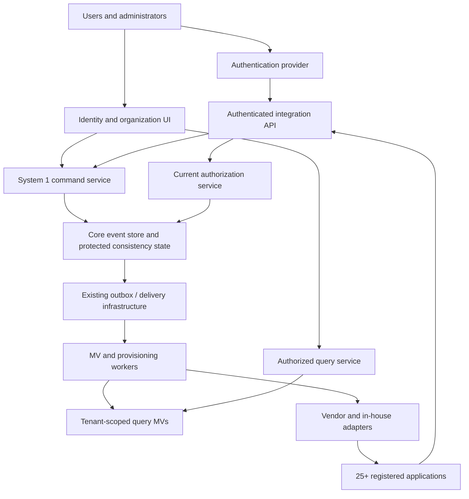

# System 1 Plan — Identity, Contacts, Memberships and Authorization

## Application contract and message delivery

The application backend integrates with EP through its API; a future MCP interface may expose the same governed operations. EP creates and validates invitations/authentication challenges and returns the result, including the delivery material the authorized calling backend needs, in that request's API response. For example, TOM requests an invitation or magic-link challenge, receives it and delivers it to the intended recipient through TOM's email/SMS/provider integration. No shared database, filesystem mailbox or EP-specific delivery worker is part of this contract.

EP owns authority checks, tenant/occasion/recipient binding, expiry, revocation, verification/redemption, idempotency and accepted facts. The application backend owns message templates, application URLs, provider credentials, sending and provider retries. The API response is the handoff: recording an invitation/challenge does not mean that a message was delivered. Delivery acknowledgments, delivery queues or a separate notification service are not prerequisites for this request/response flow; any later delivery-status reporting must be an explicit optional API capability.

Delivery material is returned only to the appropriately authorized backend. A magic-link secret is sensitive authentication material: retain only its hash/verification state in EP and keep the raw value out of ordinary events, MVs, logs and unrelated clients. An invitation ID alone remains insufficient for acceptance; the verified intended recipient and current scope/authority rules still apply. Retries/reissuance must have documented API semantics so an uncertain response cannot silently create duplicate invitations or invalidate a challenge being delivered. This boundary preserves the existing recipient verification, rate limits and anti-enumeration requirements; it does not authorize a public browser endpoint to retrieve arbitrary login secrets.

**Implementation status:** Implemented. EP returns delivery material through protected API responses; TOM constructs and delivers the messages. EP delivery workers/mailbox adapters are removed. TOM supports a private development mailbox and configurable SMTP. No delivery-acknowledgment protocol or EP notification queue is required.

## Purpose and design position

Build system 1 as the shared identity and organization control plane for **25 or more independently operated, multi-tenant systems**. It owns canonical parties, identities, occasion memberships, team structure, platform authorization policy, and delegated administration. Applications retain ownership of their business data and domain-specific decisions; third-party products need not adopt the platform's internal event-store implementation.

The core datastore is assumed available as specified in [suggested-data-store.md](suggested-data-store.md): accepted changes are committed as events in `event` and `event_details`, publication is durable, and background workers maintain near-real-time materialized views (MVs). MVs are the ordinary query path, not the source of truth. Current authorization and protected invariants use transactionally consistent state rather than lagging query views.

This plan implements the first priority in [prioritized_functions_systems.md](prioritized_functions_systems.md), using [domain.md](domain.md), [named_spaces.md](named_spaces.md), [entity-relationship.md](entity-relationship.md), [organization.md](organization.md), [suggested_systems.md](suggested_systems.md), and [use_cases.md](use_cases.md), and [gdpr.md](gdpr.md). `Tenant` is the owning workspace and `Occasion` is a camp within it; the scope hierarchy is tenant > occasion > event; an event is a recorded fact.

Deliver a modular service and administration UI with versioned contracts, a reusable application integration kit, and adapters for systems that cannot use those contracts directly. Start with one independently deployable control plane and workers, rather than creating a new service for each concept.

## Outcomes and scope

System 1 must let one person authenticate once, select an authorized occasion and operating context, and use only the resources allowed in each application. A volunteer such as LISA retains her participant and hospitality relationships without duplicated identity or accidental permission combination. Every appointment, access grant, external mapping, and material identity change is traceable.

| In scope | Boundary |
|---|---|
| Canonical human, mechanical/electronic and organization contacts, extensible tags, typed relationships, stewardship and merge history | System 1 masters IDs and reconciles external candidates; CRM and registration own their specialist profiles. |
| Identity lifecycle, verified email/phone login identifiers, federation bindings, suspension and recovery | A mature identity provider handles credentials and authentication protocols; system 1 owns platform identity and eligibility. |
| Occasion creation/configuration, membership contexts, team hierarchy and time-valid assignments | Occasion business scheduling and participant registration remain with their domain systems. |
| Roles, permissions, scoped grants, policy evaluation and delegated administration | Domain services supply trusted resource attributes and enforce domain invariants. |
| Application registry, tenant-to-vendor mapping, provisioning and access synchronization | System 21 owns general transport/integration infrastructure; system 1 owns identity integration semantics and results. |
| Organization and access administration, user self-service, audit and readiness views | Restricted health, safeguarding narratives, payment accounts, credentials and operational incidents are separate services. |

Initial delivery must prove two tenants, including sibling occasions within one tenant and at least three application profiles: a native application, an independently built in-house application, and a third-party or representative vendor integration. Design and test the registry and routing for at least 25 applications; do not require all 25 to exist before proving the contracts.

## Reconcile existing model decisions

An identity may use email, phone, or both and have memberships in multiple occasions, with **at most one membership per identity in each occasion** (even when several occasions share one tenant). LISA's memberships in `SL2026` and `SL2030` are distinct records linked to the same identity; multiple roles within either occasion share that occasion's membership.

- Give identities immutable opaque IDs. Email and phone are verified, globally unique **login identifiers**, not primary keys for relationships. Changing either does not recreate identity, membership, or application mappings.
- Enforce uniqueness of normalized active login identifiers in protected authoritative indexes. Define email normalization conservatively and phone normalization using international numbering; document reassignment, recycled numbers, and vouched recovery procedures.
- Enforce uniqueness of `(tenant_id, occasion_id, identity_id)`. Each membership has a stable ID and supports multiple roles, team affiliations and assignments. Scoped role sets govern navigation and mutations within the membership, without requiring separate memberships or participant/volunteer mode switching. Reactivation updates the existing membership lifecycle.
- Every human and mechanical/electronic alter-ego contact has exactly one identity, including imported people and children without enabled interactive login. Organizational contacts have zero or one identity. Multiple real users may use an organizational identity through explicit delegation from their own authenticated human identities. Required identities cannot be removed while leaving an active contact orphaned; optional organizational identity removal must resolve delegations, memberships and obligations.
- Membership acceptance records its retention window and relevant consent/preferences. Withdrawal does not erase other valid occasion relationships or obligations. Global identity/contact retention is decided separately from each membership's data window.

These contact-category and single-membership rules are established design requirements. Freeze implementation contracts against the aligned domain, entity, datastore and use-case documents.

## Tenant and global-scope model

A tenant is a workspace created by a signed-up individual or organizational identity; it can own zero or more occasions. Each occasion belongs to exactly one tenant and has a distinct `occasion_id`. `tenant_id`, `occasion_id` and `event_id` identify separate levels of **tenant > occasion > event** and must not be interchangeable.

`TenantAccess` records identity access and administration at tenant level, unique on `(tenant_id, identity_id)`. `Membership` records occasion participation, unique on `(tenant_id, occasion_id, identity_id)`. Tenant admins do not need to join recruitment to create or administer occasions. One organizer tenant can contain both SL2026 and SL2030, with distinct LISA memberships and grants in each.

An application tenant is a product-specific partition mapped to the platform tenant; application projects/workspaces may map to occasions. Products may instead require one isolated instance/workspace per occasion. The registry stores both levels explicitly and verifies authorization boundaries. A scout corps or supplier organization is a Party, not automatically a tenant.

Global canonical identity and party records exist in a restricted platform scope. An occasion can see only the fields and relationships it is authorized to use. Existence of a global record does not allow an occasion administrator to enumerate other occasions, discover another membership, or access another occasion's profile.

| Boundary | Rule | Enforcement |
|---|---|---|
| API requests | Explicit trusted tenant, plus occasion/context for occasion operations; absent scope never means all tenants | Validate caller, application registration, membership, route scope, and resource ownership. |
| Database | Tenant-owned records carry tenant keys; occasion-owned records also carry occasion keys and verified parent references | Composite keys/constraints plus row isolation; separate restricted global tables. |
| MVs and caches | Every tenant-derived row, query and cache entry is scoped | Tenant/occasion/application/context/policy version in keys as applicable; filtered projections and authorized query endpoints. |
| Publication | Consumer can receive only registered tenant/occasion scopes and allowed event types/fields | Scoped subscriptions, credentials, routing and payload minimization. |
| Search, exports and object storage | Same restrictions as primary queries | Tenant filters and authorization before retrieval; explicit export scope and expiry. |
| Workers | Job scope is immutable and validated, with narrowly scoped credentials | No ambient last-used tenant; isolate retry/quarantine data and reset pooled connection context. |
| Support and operations | Platform maintenance is distinct from business access | Explicit time-bound support elevation, reason and audit; no implicit cross-tenant administrator. |
| Application-local storage | Each system must enforce its own tenant boundary | Integration acceptance tests cover direct API, background jobs, exports and UI bypass paths. |

A shared PostgreSQL schema with tenant keys is the initial candidate for native modules. Row-level security can provide defense in depth; application runtime roles must not be owners, superusers, or `BYPASSRLS` roles, and relevant owner behavior must be tested. Native materialized views must not be assumed to inherit source-table row policies: expose scoped query services or tenant-protected projection tables instead of direct client database access. PostgreSQL documents row-policy behavior and bypass cases in [Row Security Policies](https://www.postgresql.org/docs/current/ddl-rowsecurity.html).

For third-party systems, require either demonstrable native tenant isolation or a separately isolated instance/workspace per occasion supported through lifecycle automation. Tags, saved filters, or a hidden tenant dropdown are insufficient. A gateway cannot prevent leakage through a vendor UI or background report it does not control. A product that cannot satisfy either isolation model is incompatible with the requirement and cannot pass onboarding.

## Signup, tenant creation and occasion launch

1. **Sign up and establish the acting identity.** An individual authenticates directly; an organizational creator is represented through its optional identity by an authorized real user. Retain operator and represented identity throughout.
2. **Create the tenant as the first tenant action.** `CreateTenant` validates platform signup eligibility, not a nonexistent prior tenant grant. Commit `TenantCreated`, creator `TenantAccess` and `TenantAdminGranted` atomically. The creator becomes `tenant_admin #1` with tenant-wide roles and permissions; idempotent retries return the same tenant and grant.
3. **Delegate tenant administration when desired.** A current tenant admin grants `tenant_admin` to one or more additional identities with explicit scope and validity. Inviting an unregistered identity leaves a pending invitation until identity verification/acceptance. Organizational grantees use individually attributable operators.
4. **Create an occasion.** A tenant admin issues `CreateOccasion` within their tenant; persist the parent binding and `OccasionCreated`. Occasion creation is available before recruiting participants or appointing camp staff.
5. **Open recruitment.** A tenant admin explicitly opens recruitment for that occasion, producing `OccasionRecruitmentOpened`. Capture campaign/intake configuration and admission rules; recruitment applications can then enter the workforce flow. This is not participant-registration opening or automatic acceptance.
6. **Assign occasion admins.** Tenant admins grant `occasion_admin` to identities for that specific occasion. Within adopted policy they administer that occasion, its recruitment and delegated roles, but cannot administer the tenant, grant tenant_admin or access sibling occasions by default.

The sequence can include additional setup tasks, but tenant authority must exist before occasion administration. Tenant admins retain tenant-wide administrative powers. Purpose-specific safeguards and business approval workflows still govern sensitive information and camp appointments. Only tenant admins (or a separately recorded tenant-level delegate with that exact capability) can grant tenant administration; occasion_admin alone cannot self-elevate.

| Role | Scope and core authority | Boundary |
|---|---|---|
| `tenant_admin` | Own tenant: delegate tenant_admin, manage tenant settings, create/manage occasions, open recruitment and appoint occasion_admin | No authority in another tenant; specialized data and business approvals retain their controls. |
| `occasion_admin` | Assigned occasion: configure its services/recruitment and administer allowed occasion roles | Cannot create sibling occasions or grant tenant_admin without separate tenant authority. |
| Camp business roles | Board, chiefs, management, function and patrol mandates within the occasion | Technical admin grants do not replace business selection or approval. |

Protect tenant continuity: last-admin removal/expiry must use a reviewed handover or recovery path. Record owner/creator separately from current grants; creation does not create an irrevocable personal entitlement. Tenant closure resolves active occasions, external bindings and obligations rather than silently deleting them.

## Logical components

Keep authentication, authorization decisions, query views, and external provisioning distinct. Sharing an SSO login is not sufficient to enforce TenantAccess, occasion membership or domain permissions.

## Canonical records and invariants

| Record | Minimum fields and behavior |
|---|---|
| `Party` | Immutable ID, human/mechanical-electronic/organization category, lifecycle and provenance. Field ownership and tenant-specific profile visibility are explicit. |
| `Identity` / `identity` table | Dedicated, restricted store for immutable principal ID, identifying fields/bindings, linked Party, lifecycle/security revision and retention state. Enforce category-specific identity requirements; use issuer/subject for federation. Other systems normally use opaque references rather than copying identifying fields. Expiry/erasure clears identifying data and links, leaving only a non-identifying structural stub where justified. |
| `IdentityUseDelegation` | Operator human identity, represented organizational identity, tenant/application/resource scope, allowed actions, validity, grantor, approval and revocation revision. Several operators may represent one organizational identity. |
| `LoginIdentifier` | Type, normalized value, verification state/time, identity link, active/retired state. Protected lookup/verification data has separate access. |
| `Tenant` | Stable ID, creator/owner identity, lifecycle and tenant policy; creation atomically establishes first tenant_admin. |
| `TenantAccess` | Tenant and identity, status/validity and administrative grants; unique `(tenant_id, identity_id)`, independent of occasion participation. |
| `Occasion` | Stable ID, required parent tenant, lifecycle, recruitment state, participating organizations, policy defaults and administrators. |
| `Membership` | ID, tenant and occasion, required identity reference and its linked Party, optional context, status, validity, retention/consent references. Unique `(tenant_id, occasion_id, identity_id)`; multiple role contexts share this record. |
| `Team` and `TeamMembership` | Tenant, occasion, parent, team type, member context and validity; reject cycles and cross-tenant or cross-occasion parents. Operational and scout-team types remain distinct. |
| `PartyRelationship` | Typed endpoints, scope, validity, provenance, steward and permissions. No management authority inferred from descriptive contact tags. |
| `RoleDefinition` / `PermissionDefinition` | Versioned namespace-qualified capabilities, description, supported resource scopes and policy constraints. |
| `Grant` / `Delegation` | Target, tenant plus optional occasion according to scope, role or permission, resource/team scope, validity, issuer, approval and delegation ceiling. Deny/override semantics are explicit. |
| `Appointment` | Selected person/context, position, selecting authority, approval requirements, effective dates and deputy/delegation links. |
| `Application` / `ApplicationTenantBinding` | Application ID, owners, integration profile, auth audiences/clients, capabilities, tenant mappings, health and lifecycle. |
| `ExternalBinding` | Application/source, external tenant, object type/ID, canonical ID, provenance and mapping version. Unique within external scope; retain reconciliation history. |
| `ProvisioningOperation` | Desired revision, external result, retries, reconciliation evidence and unresolved errors. |

Protect uniqueness and canonical-reference integrity transactionally. Party merging records surviving and retired IDs, merge authority, field decisions and redirects; it does not rewrite original events. Merging parties does not automatically merge authentication accounts or broaden permissions. Email/phone matches can suggest reconciliation but cannot silently bind an attacker-controlled external account.

## Dedicated identity storage and non-identifying continuity

Place `Identity` in its own restricted `identity` table as a security and lifecycle boundary. Keep human-identifying attributes and their resolution links in this controlled store or tightly controlled dependent tables/provider records: names used for identity resolution, verified login identifiers, federation subjects, recovery contacts and external identity bindings. Domain records refer to the opaque `identity_id`; they do not embed reusable copies of these attributes for convenience. Party profiles, relationship endpoints and vendor mappings that can identify the same person remain in the erasure inventory, regardless of which table owns them.

**Default persistence is bounded.** At the end of the applicable membership/service retention window, users who have not opted into approved extended persistence enter the retirement workflow. A deletion request starts a rights-assessment workflow without waiting for normal expiry. Extended persistence is purpose-specific, records its notice/authority/period, and can be withdrawn where consent is relied upon; it is not a permission to retain everything indefinitely. Continuing active relationships or documented retention exceptions are assessed separately and cannot be used to retain unrelated expired content.

The intended outcome is that cleared identity data no longer resolve the retained ID to a person or permit identifiable profiling. The implementation may pseudonymize fields during processing, but pseudonymization alone is not completion of erasure: if Party data, vendor IDs, old messages, membership history, unique appointments or other reasonably available information still identify the person, those eligible identifying links/content must also be removed, redacted or deleted. A durable opaque ID may preserve record structure only where the residual data are genuinely non-identifying or their retention is independently justified and restricted. A stable ID can still correlate activity, so do not describe it as automatically useless for profiling merely because names were removed.

### Retirement and deletion workflow

1. **Determine scope and authority:** Identify the subject and all related scopes, affected purposes, extended-persistence choices, continuing memberships and specific retention exceptions/holds. Occasion expiry clears eligible occasion data; global identity clearing occurs when no continuing justified identity purpose remains. A global deletion request is assessed across the relevant controllers and applications.
2. **Block continuing use:** Retire affected contexts; revoke sessions, grants, organizational acting-as delegations, machine/operator bindings and external access as applicable. Transfer last-admin or operational ownership through the approved continuity process without preserving unnecessary personal attribution.
3. **Clear identity resolution:** Pseudonymize/redact or remove identifying fields from `identity` and its dependent login/federation/recovery tables, Party/profile data, mappings and provider records. Do not retain original values, reversible lookup maps or guessable hashes in ordinary history. Remove credentials and prohibit login/recovery against the retired stub.
4. **Handle content conservatively:** Replace eligible personal chat messages, text, images, photos, audio and video with non-identifying placeholders as whole content items when reliable selective redaction cannot be established. Remove originals, attachment objects, thumbnails, transcripts, OCR, metadata, quotations and other controlled copies that identify the subject. Delete the item outright where placeholders/redaction cannot prevent identification or where the remaining structure is unnecessary.
5. **Preserve safe operation:** Keep justified non-identifying work state, quantities, dependency links and aggregate results; display generic labels such as “Removed participant” or “Content removed.” Avoid a stable public alias or explanation that reveals the person. Multi-person artifacts require review to address the subject's data while protecting others' information and applicable rights.
6. **Propagate and verify:** Apply changes to event envelopes/details, snapshots, MVs, caches, indexes, outbox/inbox, quarantine, exports, offline devices and vendors. Recompute affected derived values and remove attribution where necessary. Obtain recipient acknowledgements and flag incomplete work rather than claiming success after clearing only `identity`.
7. **Prevent resurrection:** Maintain a minimal, restricted suppression/deletion registry with justified retention. Replay, import, vendor sync and backup restoration must consult it before serving or republishing data. A later signup must not relink a cleared historical identity or restore old content through identifier matching.
8. **Complete with evidence:** Record minimal request/expiry outcome, approved retained subsets and verification results without copying the erased identifiers or content into the completion event. Apply the requirements and exception assessment in [gdpr.md](gdpr.md).

This changes privacy-sensitive source records through a specifically authorized lifecycle process even where ordinary business events are append-only. An appended retirement event, UI placeholder or lost hyperlink is insufficient while accessible originals remain in storage. Structural stubs retain no enabled authority and are distinct from active contacts, so the required-identity invariant for active human/machine contacts does not mandate perpetual identifiable retention.

### Content and reference contract for every application

Applications must declare where an identity reference can resolve to personal data, including content authored by or about a person. They expose expiry/erasure jobs with per-object outcomes: cleared identity, non-identifying placeholder, deleted content, justified restricted retention, or unresolved failure. Consumers handle missing/redacted references without crashing or repeatedly requesting removed content. MVs remain useful operational read stores while historical personal messages and media become unavailable; operational availability never depends on retaining unnecessary identifying content.

## Authentication and account lifecycle — adopted decisions

**Username/password authentication is excluded.** The first user supplies an email address or phone number and receives a magic link through that channel. After verification, they can remain on magic links, use six-digit email/SMS verification codes, or configure OpenID Connect authentication. Provider selection must support these choices without enabling a platform username/password route. Federated credentials are administered by the chosen provider; platform recovery follows the vouched process below.

1. **Enroll:** Verify possession with a single-use, short-lived magic link. Rate-limit delivery and redemption, prevent account enumeration, bind the attempt to its intended identity/scope, and keep links/codes out of event payloads and logs.
2. **Choose authentication:** Record the user's chosen magic-link, six-digit-code or OpenID Connect method. Codes are single-use, expire and have bounded attempts; method changes require current authority and verification of the new channel. Identity IDs remain stable.
3. **Invite or publish signup routes:** The first admin can invite a team and/or open multiple slug-based signup/signin routes. Each slug resolves to an explicit tenant, occasion where applicable, and organization/team context such as function leads, function teams or patrols. A slug selects context; it is not a credential or an unrestricted role grant.
4. **Vouch for invitations:** Any user may propose an invitation. Their team lead must vouch before admission/assignment becomes effective; invitation acceptance verifies the invitee's email/phone. An invitation can target an existing organization or propose creation of a new one. Review and granted scope remain bounded by the lead's authority. Bootstrap admin invitations use the corresponding authorized tenant/occasion lead approval rather than requiring a nonexistent patrol lead.
5. **Apply roles:** The user has a set of scoped roles governing navigation, visible fields and permitted mutations. LISA's participant and volunteer roles share one occasion membership. Roles do not require separate memberships or mandatory participant/volunteer mode switching; tenant, occasion and represented-organization scope selection remains explicit.
6. **Recover after phone loss:** A user with greater, explicitly authorized recovery permissions vouches for the person and supplies a new phone number or email. Record voucher, subject, evidence/reason and scope, verify the replacement channel, revoke the lost channel/session bindings, and notify appropriate verified channels. Recovery cannot be self-approved or confer the voucher's roles. Last-admin recovery uses the governed platform recovery path.
7. **Suspend/retire:** Revoke the affected grants and downstream sessions/accounts. Organization retirement also retires users' assignments/access under that organization; preserve other valid organization/occasion relationships and the canonical human identity unless the wider identity lifecycle separately requires retirement.
8. **Close/expire/erase:** Execute the identity-clearing and content lifecycle, including non-opted-in expiry, placeholders/deletion, backup sanitization and replay suppression; retain only independently justified restricted obligations/evidence.

Use supported authentication infrastructure and OpenID Connect contracts rather than custom credential protocols. [OpenID Connect Core](https://openid.net/specs/openid-connect-core-1_0.html) provides the authentication contract; API access still requires audience-bound tokens and current authorization. Validate issuer, signature, lifetime and intended client/audience. ID tokens are not generic API access tokens. Machine authentication uses the separately governed token workflow below.

## Authorization and delegation

Define an authorization request as `(operator_identity, represented_identity, delegation_id, application, tenant, occasion, membership_context, action, resource, purpose, trusted_attributes)`. For direct action, operator and represented identity are the same and no acting-as delegation is needed. Domain services provide resource ownership, assignment and classification; callers cannot invent attributes that grant themselves access.

Permissions are namespace-qualified, for example `identity.identifier.change`, `tenant.create`, `tenant.admin.grant`, `occasion.create`, `occasion.recruitment.open`, `occasion.admin.grant`, `membership.accept`, `team.members.manage`, `appointment.function.select`, `registration.health.read`, and `finance.refund.approve`. System 1 evaluates current grants, validity, hierarchy, policy and delegations. Domain systems then enforce their own approvals, financial constraints, qualifications, or incident-command rules.

- Deny by default. Roles are permission sets with explicit scope; contact tags and SSO group names are not unrestricted authority.
- Inheritance follows approved scope rules: tenant_admin has explicit tenant-wide administration; occasion_admin and team grants stay within their occasion. No implicit authority crosses tenants or sibling occasions.
- Function leads appoint patrol staff only within their own function and may delegate that appointment authority within the same boundary. Delegators cannot grant beyond their authorized scope, validity, allowed capabilities, or delegation ceiling. Moving a team or changing a role definition triggers impact review and recomputation.
- Shared CEO authority belongs to two recorded chiefs. Joint-action requirements are explicit workflow rules, not two unrelated role grants presumed to constitute joint approval.
- Chiefs select management; the Board approves; approved management members select function staff; authorized function members select patrol staff. Qualifications/clearance come from their owning services with accepted evidence and a freshness contract.
- Separate technical administration from permission to inspect personal cases. Purpose and field-level restrictions apply to query results and exports.
- Provide evaluated decision ID, allow/deny, policy/security revision, permitted scope/field mask and expiry. Record denied privileged operations and restricted reads as security audits.

**Revocation contract:** Native services use current checks for sensitive operations; security changes increment revisions atomically with events and protected authorization state. Cache keys include applicable revisions with an enforced invalidation/fencing strategy. A commit-sensitive grant must be rechecked or fenced against concurrent revocation; a check performed earlier in a request is insufficient. Across services, document whether the decision is linearized at authorization or revalidated at final effect, and do not promise atomic cross-database revocation without a supported mechanism.

Third-party cached roles and sessions may have unavoidable propagation delay. Record each application's measurable revocation bound and deprovisioning evidence; sensitive access requires a synchronous enforcement mechanism, sufficiently bounded session model, or isolated shutdown route that meets the adopted requirement. Failed revocation triggers escalation and containment, not a green provisioning status. Emergency fallback privileges are preapproved, bounded, separately audited and cannot silently bypass tenant isolation.

## Organizational identity use and machine principals

An organization may remain a contact without an identity, or acquire an optional identity through a governed command. When it has an identity, its own roles and at-most-one membership per occasion are distinct from the personal memberships of its operators. Adding operators does not duplicate the organizational identity or organizational membership.

A real user authenticates as themselves, selects an authorized organization and occasion, and requests a bounded acting-as context. Acceptance requires the operator to be active, the organizational identity/membership to be valid, a current `IdentityUseDelegation`, and the organization's permission for the action. The effective permission is bounded by organizational grants, delegation scope, and applicable operator eligibility/constraints; it is not the union of personal and organizational privileges. The organization relationship alone confers no acting-as permission.

Grant, revoke, expire and review operator access individually. Revoking one operator preserves other valid operators and the organizational identity; disabling the organizational identity blocks all its acting-as sessions. Organization retirement retires its assigned users in that organizational scope, revokes their delegated organizational access and downstream assignments, and emits auditable retirement tasks. It does not automatically delete the human identity or unrelated memberships. Optional identity removal retires or resolves its memberships and provisioning, preserves approved history, and leaves the organization contact intact. Deletion/retention follows the same governed rules as other identities.

Machine or electronic alter-ego contacts receive their own stable identities with token-based credentials created by occasion admins, plus owner, occasion scope and lifecycle. Tokens are rotated/revoked manually on request, with each operation audited. Tokens may be restricted to an MV, queue consumer or application endpoint; this is an optional capability, not authority sourced from lagging MV rows. Token validity/revocation uses current protected control state. Store verifiers or protected secrets, reveal bearer secrets only through the approved issuance workflow, and never write token values into events. Record the machine actor and human initiator when present; a machine identity is not an anonymous organizational operator.

Every command, event, audit, external effect and supported token/context records the actual operator, represented identity and delegation reference. API clients cannot choose those fields arbitrarily; establish them through verified session/token binding and current policy. An adapter preserves operator attribution when a vendor only exposes an organization account; onboarding must document what the vendor can enforce and audit. Delegated user access supports the requested shared organizational identity without requiring shared login secrets.

## Commands, events and APIs

| Command family | Accepted event examples | Acceptance rules |
|---|---|---|
| Establish/change Party, tags and relationships | `PartyEstablished`, `PartyFieldReconciled`, `PartyMerged`, `PartyRelationshipChanged` | Provenance, stewardship, uniqueness/reference checks and field authority. |
| Enable/use organizational Identity | `OrganizationIdentityEstablished`, `IdentityUseDelegationGranted`, `IdentityUseDelegationRevoked`, `OrganizationIdentityRetired` | Optional organization identity, individual operator authority, scope/validity and dependent membership/provisioning lifecycle. |
| Verify/link/suspend Identity | `LoginIdentifierVerified`, `IdentityLinked`, `IdentitySuspended` | Verification evidence, stable subject binding, protected uniqueness and account authority. |
| Create/administer Tenant | `TenantCreated`, `TenantAdminGranted`, `TenantAdminRevoked`, `TenantClosed` | Signup eligibility for creation; atomic first-admin grant; current tenant authority for later delegation/lifecycle; continuity safeguards. |
| Create/administer Occasion | `OccasionCreated`, `OccasionRecruitmentOpened`, `OccasionRecruitmentClosed`, `OccasionAdminGranted`, `OccasionAdminRevoked`, `OccasionClosed` | Current tenant authority for creation/admin assignment; occasion-parent binding and scoped lifecycle/recruitment rules. |
| Invite/accept/end Membership | `MembershipInvited`, `MembershipAccepted`, `MembershipEnded` | Context, validity, retention terms and no unintended role union. |
| Establish/move/join Team | `TeamEstablished`, `TeamMoved`, `TeamMemberAssigned` | Same tenant and occasion, no cycles, authorized scope and validity. |
| Grant/revoke authority | `RoleGranted`, `PermissionGranted`, `DelegationGranted`, `GrantRevoked` | Current authority, ceiling, scope, validity and required approvals. |
| Select/approve/activate appointments | `CampChiefAppointed`, `ManagementTeamSelected`, `ManagementTeamApproved`, `FunctionStaffSelected`, `PatrolStaffSelected` | Exact selecting/approving chain, effective dates and clearance evidence. |
| Vouch invite/recovery and configure signup slug | `InvitationProposed`, `InvitationVouched`, `RecoveryVouched`, `SignupSlugConfigured` | Appropriate lead/higher recovery authority; replacement-channel verification; slug scope never substitutes for permission. |
| Manage machine/MV token and queue access | `MachineTokenIssued`, `TokenRotated`, `TokenRevoked`, `QueueConfigured`, `MVQueueBound`, `MVStopped`, `MVResumed` | Occasion-admin token issuance; tenant-admin queue/MV controls; protected current scope/state and no credential secrets in payloads. |
| Review expiry and remove backup data | `OccasionExpiryReached`, `OccasionProlonged`, `OccasionRetired`, `BackupSanitizationRequested`, `BackupReplacementVerified` | Idempotent admin review, purpose/opt-in controls, indexed backup coverage and verified original removal before completion. |
| Register/bind/provision Application | `ApplicationRegistered`, `ApplicationTenantBound`, `ProvisioningRequested`, `ProvisioningConfirmed`, `ProvisioningFailed` | Reviewed configuration, tenant isolation, desired revision and verified external result. |

Expose versioned endpoints such as:

- `POST /v1/tenants/{tenant_id}/occasions/{occasion_id}/commands` — authenticated typed commands with idempotency key, expected stream versions and explicit acting context.
- `POST /v1/tenants` — authenticated self-service tenant creation with atomic first-admin grant and idempotency.
- `POST /v1/tenants/{tenant_id}/commands` — tenant-admin delegation and occasion creation, including opening recruitment and assigning occasion admins.
- `GET /v1/me/contexts` — authorized tenants, occasions, tenant-admin contexts and occasion membership contexts only.
- `GET /v1/tenants/{tenant_id}/occasions/{occasion_id}/directory`, `/teams`, `/memberships`, `/organization` — scoped MV-backed queries with field filtering, pagination and freshness metadata.
- `POST /v1/authorization/decisions` — current policy evaluation for registered resource servers; authenticated caller and trusted attributes required.
- `GET /v1/applications/{application_id}/provisioning-status` — authorized per-tenant desired/applied revisions and failures.
- Scoped subscription bootstrap and change delivery — through system 21's transport, with system 1's audience and field policies.

Accepted command responses include command ID, event IDs and committed versions. Asynchronous external work has a separate operation ID/status; HTTP success for local acceptance does not claim vendor provisioning is complete. Conflicts, denied commands, malformed contracts and unavailable authority are distinguished. Define OpenAPI/JSON schemas, compatibility rules, SDK fixtures and error vocabulary as delivery artifacts; URL examples above are proposed contracts rather than implemented endpoints.

## Import matching and yellow-list review — adopted decisions

Strong matching identifiers are **email, phone, and postal address plus name**. Normalize conservatively, preserve source/field authority and use these as candidate matching inputs. Automatically reconcile an unambiguous trusted match when the import policy permits it; conflicting identifiers, multiple candidates or shared/recycled identifiers cannot silently merge people or bind authentication credentials. Postal address plus name is a strong input, not proof of control of a login account.

Generate a **yellow list** for imported records that resemble existing records but cannot be confidently merged. Create a restricted review WorkItem assigned to the **Participant Experience and Programme Lead**, showing source provenance, candidate records, matching/conflicting fields and proposed outcome. The lead or an explicitly authorized delegate accepts a match/merge, keeps records separate or requests evidence. Record the result and field-level reconciliation; repeated imports reuse the decision where still valid. No import match alone enables someone to authenticate as another user.

## Application access scope — adopted decisions

Vendors are treated as isolated systems. Tenant admins configure each application binding as **tenant-wide** or **occasion-wide**. Tenant-wide bindings identify that tenant's allowed occasion contexts; occasion-wide bindings carry one explicit `(tenant_id, occasion_id)`. These settings are maximum access boundaries, not permission to read every field or bypass user roles, purpose restrictions or vendor review.

Adapters issue scoped tokens/subscriptions and minimize fields accordingly. Test the vendor's actual storage, UI, export and support access against the configured boundary. Changing a binding's scope is a governed command that reconciles previous access/copies before reporting completion. An application without adequate enforceable isolation cannot acquire extra access merely because it is marked tenant-wide.

## Occasion expiration, prolonged retention and backup removal — adopted decisions

Tenant admins set an **expiry date or duration** when creating an occasion. A duration is resolved against a recorded start/reference time, so expiration is reproducible. Crossing it emits an idempotent WorkItem for tenant admins to confirm expiration or prolong it, with decision, reason and new date recorded. Pending review cannot silently extend collection or override already applicable purpose-specific deletion duties; disable new intake at the boundary by default and enforce existing data limits. Prolonging an occasion does not automatically extend each user's retention consent or expired lawful purpose.

On occasion retirement, **only users who opted into prolonged data retention have their eligible personal data retained for reconstruction**, within the agreed purpose and period. Other users' eligible identifying links and content are cleared/deleted and reconstruct as safe stubs/placeholders. Independently required restricted legal records and non-identifying operational totals have separate retention and are not replayable personal profiles. Continued identity needs in another active occasion do not authorize replaying this retired occasion's erased content.

Maintain a protected **backup-subject index** identifying which users' data occur on **every backup**, including event payloads, media, indexes, snapshots and incremental chains. Record backup ID, location/custodian, generation/dependencies, subject references, format, state, expiry, removal operations and verification. Cover affected subjects, not only authors/actors. Keep this index access-limited and retention-bounded; it is itself personal data.

An approved deletion creates tasks for every affected backup. Diligently request offline media to be brought online in an **isolated sandbox**, restore/decrypt only within that controlled environment, apply erasure to all source/derived artifacts, and verify absence through the same subject/content inventory used for live stores. Create a sanitized replacement backup and retire/destroy the original copy and applicable old versions/media; deleting only a restored sandbox copy leaves the original unchanged. Update dependent incremental chains and the index before declaring removal complete. Disable outbound publication, user access and external effects in the sandbox, then erase its temporary files and credentials.

For immutable or inaccessible media, record unresolved removal with custodian, due date and escalation; use approved expiry/destruction or a feasible replacement strategy. Suppression on restore protects operation while physical removal is pending but is not falsely reported as deletion of the backup. Vendor backups require contractual support and verified outcomes. Restoration must apply the latest suppression registry before any data become available; maintain its protected evidence outside the historical backup generation being restored.

## Configurable clearance freshness — adopted decisions

Each occasion has configurable mandatory freshness limits for safeguarding and qualification evidence. Appointment/assignment acceptance checks the current required evidence type, issue/expiry/revocation state, age against the occasion policy, and any domain authority requirements. Missing, stale or revoked evidence blocks acceptance; a stale MV hint cannot authorize the appointment. Record policy/evidence versions and evaluated time. Updated limits create review tasks for existing appointments rather than silently declaring their old evidence current.

## MV plan and consistency

Tenant admins can create tenant-scoped queues, configure the accompanying background job, and bind each MV to one of those queues. Job configuration includes permitted source events/fields, tenant/occasion scope, worker identity/token, schedule/batch policy, retry/quarantine handling, resource limits, retention and checkpoints. Permit approved job templates/parameters; configuration is not arbitrary privileged code execution or direct unreviewed SQL.

Each MV has a protected current control record: scope, queue/job binding, lifecycle state and assigned token references. Setting **`stopped` revokes MV serving/access**, including reads, subscriptions and propagation, rather than merely freezing refresh while leaving old rows accessible. Revoking an MV-assigned token blocks that credential individually; stopping the MV blocks all its serving paths. Requests check this control state independently of the asynchronous MV. Capture stop/revoke audit and reconcile application caches/delivery already issued. Resume catches up required deletions/restrictions before allowing reads again; stopping ordinary work cannot prevent mandatory cleanup.

Tenant admins set **special erasure-propagation time windows** per MV/job. Record timezone, eligible window, due time and emergency override; immediately suppress restricted/erasable data from serving while physical cleanup is scheduled. Window selection must remain within the applicable privacy deadline and cannot indefinitely defer tasks because a queue/MV is stopped. Monitoring escalates missed windows and drives approved cleanup outside the normal window when required. Numeric performance objectives remain implementation choices, measured against these controls.

| MV | Purpose | Background update and consistency rule |
|---|---|---|
| `identity_profile` | Self-service and approved profile lookups | Minimal visible data; global access restrictions retained. |
| `tenant_directory` and `tenant_admins` | Tenant access, administrators and owned occasions | Tenant-scoped background views; creation/delegation validation uses current protected state. |
| `occasion_recruitment_status` | Recruitment state and intake configuration | Occasion-scoped incremental updates; command acceptance rechecks current open/closed state. |
| `occasion_directory` | Contacts visible in one occasion | Incremental membership/party changes; no cross-occasion enumeration. |
| `membership_contexts` | Context selection and lifecycle status | Incremental; current authority still validates context activation. |
| `team_tree` and `organization_current` | Hierarchy, staffing and escalation directory | Affected subtrees recomputed; selection, approval and effective status remain distinguishable. |
| `effective_access_explanation` | Explain grants and delegation to administrators | Derived diagnostic view; cannot authorize sensitive operations. |
| `application_access_desired` | Desired tenant/app provisioning state | Coalesce revisions safely; revoke changes receive priority. |
| `application_access_applied` | Vendor acknowledgement and drift visibility | External evidence/version included; never infer completion from publication. |
| `identity_governance_status` | Pending verification, orphan checks, ambiguous matches, expiring authority | Background consolidation with named resolution owners. |

Workers process only committed events, update affected records in batches, and commit checkpoint plus changes together. Expose processing lag, generation and source revisions; preserve safe ordering/gap handling from the core plan. Use shadow rebuild and validated switch-over. Authoritative login uniqueness, grant validity and acceptance checks use protected synchronous state or snapshot-plus-tail with concurrency protection, not periodic full-history query aggregation.

## Integrating 25+ heterogeneous systems

Register every application and each occasion binding before access or synchronization. Maintain a capability matrix rather than assuming every product supports OIDC, SCIM, fine-grained authorization, or the event protocol.

| Integration profile | Authentication and provisioning | Authorization and data contract |
|---|---|---|
| **Native regime** | Shared authentication, command/query APIs, event subscriptions and SDK | Current decision service and domain guards; canonical IDs and explicit tenant scope. |
| **Independent in-house** | OIDC where possible; APIs/webhooks or SCIM-style adapter; local implementation can differ | Mandatory tenant enforcement and ownership contract; permissions mapped and parity-tested; central changes acknowledged. |
| **Third-party SaaS** | Vendor-supported OIDC/SAML and SCIM/API/manual exception workflow | Map platform tenant and occasion to vendor tenant/workspace/project or isolated occasion instance; capability-specific roles/attributes; reconcile actual access and documented gaps. |
| **Isolated per-occasion deployment** | Automated instance/client/account provisioning per occasion | Distinct credentials, storage, exports and administration; lifecycle and operational cost included in acceptance. |

[SCIM RFC 7644](https://www.rfc-editor.org/rfc/rfc7644.html) provides a provisioning protocol, including implementation considerations for multi-tenancy; it does not itself certify a vendor's isolation or implement the camp's custom authorization rules. Represent groups/roles only when their vendor semantics match the intended scope, and use controlled extensions/mappings for canonical IDs.

Each adapter maintains `(application_id, external_tenant_id, object_type, external_id) -> canonical_id` plus desired/applied revisions. Adapters are trusted principals with minimum tenant and field scope. A vendor webhook is authenticated and deduplicated, then treated as a reported outcome or reconciliation input; it cannot directly append `RoleGranted` or override mastered identity.

Bootstrap a consumer from a scoped snapshot tied to a safe checkpoint, then apply subsequent changes without gaps. Use filtered integration representations rather than exporting the whole core event log. Reconcile desired versus actual accounts, memberships and permissions periodically and after failures. Source-origin metadata and idempotency prevent circular updates. Failed mappings, ambiguous matches and unsupported grants enter a review queue.

An application onboarding pack includes ownership, tenant model, authentication clients, permission vocabulary/mapping, field authority, contracts, fixtures, retention/export behavior, revocation bound, reconciliation schedule, failure containment, operational contacts, and exit procedures. Native and non-native systems must satisfy the same boundary outcomes even when their implementation differs.

## Administration workflows and bootstrap

The UI provides separate self-service and privileged administration: identifier verification, context selection, invitations, contact stewardship, team staffing, scoped delegation, appointment approvals, application onboarding and synchronization failures. Show selected occasion/context consistently; actionable status distinguishes proposed, accepted, effective and provisioned.

Bootstrap platform operators through a controlled infrastructure setup procedure; this is separate from ordinary tenant creation. An eligible signed-up identity self-serves tenant creation and atomically becomes tenant_admin #1 without a platform operator manually appointing them. That admin can delegate tenant admins, create an occasion, open recruitment and assign occasion admins. Establish corps representation and the Board/chief/management chain within the occasion afterward. Technical admin status does not substitute for business appointment approval. Retain controlled recovery and last-admin continuity procedures.

Team changes preview affected memberships, inherited grants and application provisioning. High-impact actions require applicable approval and an impact summary. Sensitive party matches and account linking require steward review; routine scoped invitations remain delegated to authorized team leaders.

## Delivery work packages and exit gates

The datastore is already in place; verify its required guarantees rather than rebuilding system 21. Deliver system 1 alongside the P0 slices of systems 21, 19, 5, 20 and 8: protocol, documents, WorkItem planning, MV observability and basic notifications. Recruitment opening depends on accepted intake in system 3 and the shared safeguards slice of system 2. Dates and staffing follow team capacity, provider choice and vendor access, so the plan uses dependency-based gates.

| Package | Deliverables | Dependencies | Exit gate |
|---|---|---|---|
| **1. Contract and model baseline** | Scope model, ownership matrix, identity/membership decisions, permission vocabulary, application capability inventory, threat/failure scenarios | Domain owners, two tenant definitions and multiple occasions, core-store contract | Confirm single-membership and category-specific identity invariants; define human, machine and delegated organization authentication; approve isolation and revocation requirements. |
| **2. Tenant foundation and bootstrap** | Tenant/occasion/global records, self-service first-admin grant, scoped APIs/runtime roles, event schemas, current consistency state, setup workflow, isolation harness | Package 1 and existing core datastore | Signup-to-tenant-to-recruitment flow succeeds; tenant and sibling-occasion isolation enforced; tenant/occasion admin delegation and Board/chief setup succeed. |
| **3. Authentication and identity lifecycle** | Provider integration, email/phone verification, immutable bindings, invitations, suspension/recovery, self-service | Package 2 and provider configuration | Duplicate identifier races rejected; account linking secure; required child/machine identities and optional multi-operator organization identity proven; multi-occasion login and recovery proven. |
| **4. Contacts, memberships and hierarchy** | Party stewardship/imports, single membership per identity/occasion with role contexts, typed relationships, teams, background directory/organization MVs | Packages 2–3 | JOE/LISA scenarios work; role and scope boundaries remain enforced; merge and hierarchy changes preserve provenance. |
| **5. Policy and appointment governance** | Current decision API, grants/delegation, revocation strategy, approval chain, explanation views, admin UI | Packages 3–4 and specialist evidence contracts | No scope escalation; concurrent revocation behavior demonstrated; full Board-to-patrol appointment chain audited. |
| **6. Application integration kit** | Registry, schemas/SDK, snapshot/change contract, vendor adapter interface, provisioning/reconciliation views | Packages 2–5 | Native, independent in-house and vendor profiles pass tenant/auth/provisioning contract tests. |
| **7. Production readiness** | Monitoring, restore/replay, identity clearing and content erasure, retention, operational runbooks, support elevation, load/failure tests, rollout and containment | Packages 1–6 | Agreed objectives measured; on-call owners and recovery procedures exercised; no unresolved isolation or privileged-access failures. |

Packages 3–5 can develop partly in parallel against approved contracts; acceptance remains dependent on the earlier gates. Vendor capability discovery starts in package 1 because lack of isolation, provisioning, or revocation support can change the integration choice before implementation is sunk.

## Verification scenarios

- Verify email/phone magic-link onboarding, optional six-digit codes/OpenID Connect, absence of username/password endpoints, and higher-permission vouched recovery with new-channel verification.
- Exercise multiple slugs targeting occasions and organizational/team levels; accepting a slug or invitation alone cannot grant authority, and team-lead vouching is required.
- Retire an organization and verify all its assigned-user access is retired while unrelated memberships survive; manually rotate/revoke machine and MV tokens.
- Create/bind queues and jobs, stop an MV and test every serving path, revoke one token, miss an erasure window and resume safely after cleanup.
- Import exact and ambiguous identifier matches; yellow-list tasks reach Participant Experience and Programme Lead, with no automatic authentication-account takeover.
- Cross an occasion expiry once under retries, approve prolongation/retirement, replay opt-in-only personal history, and sanitize indexed offline/incremental backups without leaving the original accessible.
- Configure clearance aging; missing, stale or revoked evidence blocks appointment/assignment acceptance even when an MV says eligible.

- Expire a user's approved persistence window without extended opt-in; clear eligible identity fields and links, retire authority and remove personal content while work queues, quantities and safe aggregates remain operational.
- Request deletion with chat/photo/audio attachments and controlled copies in transcripts, thumbnails, quoted text, events, MVs and vendors; verify placeholders contain no identifying detail and originals cannot be retrieved through alternative paths.
- Attempt reidentification using retained IDs, Party profiles, unique positions, timestamps, vendor mappings and activity combinations; treat residual identifiable data as unresolved erasure or documented restricted retention, not anonymous by assertion.
- Replay events, restore backups and reimport old identifiers after clearing; verify suppression and no resurrection/relinking. Test another active occasion and narrowly justified holds without retaining unrelated expired content.

- Sign up as an individual and as a represented organization; create a tenant with atomic first-admin authority, retry safely, add another tenant admin, create an occasion, open recruitment and assign occasion admins. Verify an occasion admin cannot grant tenant_admin or affect sibling occasions, and recruitment closure rejects new intake under concurrent changes.
- Register two tenants, including two occasions within one tenant, with the same person holding distinct occasion memberships/roles; test tenant substitution in tokens/routes, guessed IDs, pooled connection reuse, subscriptions, MVs, exports and vendor accounts.
- Represent JOE with his required identity and guardian links, even with limited or absent interactive login; guardians and scout leaders do not gain unrestricted personal-data access.
- Create an organization with no identity and another with an identity used by two real users. Verify both operators are individually attributable, one operator's revocation leaves the other authorized, organization suspension blocks both, and optional identity retirement leaves the contact intact.
- Establish a machine/agent contact with its required identity and scoped credentials; verify lifecycle, ownership, actual actor and human initiator attribution without conflating it with a shared organization identity.
- Give LISA separate memberships in `SL2026` and `SL2030`, each linked to the same identity; participant and hospitality contexts share the single membership in their occasion. Reject concurrent duplicate membership creation and verify role-set navigation/mutation boundaries and explicit tenant/occasion scope.
- Race verification of the same email/phone, duplicate commands, merge requests and team moves; reject conflicts without duplicate identities, cycles or expanded authority.
- Select management through both chiefs' workflow, obtain Board approval, then select function and patrol staff; unauthorized or expired selectors and missing clearance cannot activate authority.
- Revoke a grant or suspend identity during a write, cached session and vendor outage; measure actual propagation/containment against each contract.
- Crash before/after event commit, publication, MV update and vendor acknowledgement; retry does not duplicate invites, grants or accounts, and accepted work remains recoverable.
- Rebuild MVs with mixed event versions and redacted source data; validate lineage and supported replay horizon without reissuing invitations or grants externally.
- Introduce vendor-side drift, stale webhooks, reordered revisions and account deletion; reconciliation distinguishes proposed changes, observed facts and accepted canonical decisions.
- Exercise at least 25 registered applications with different audience/tenant mappings and lagging consumers; test peak directory, context selection, authorization and provisioning load based on measured camp demand.

## Operations, objectives and rollout

Before production, set numeric objectives for login/query/decision latency, service availability, MV lag, native/vendor revocation, provisioning recovery, and datastore recovery point/time. Separate security decision availability from directory freshness: stale MVs may be usable for display, while unavailable sensitive authorization must follow the approved failure policy. The 30,000–40,000 participant scale in the domain is a workload input, not a prediction that everyone logs in simultaneously.

Monitor per-tenant and per-application request/denial rates, identity verification abuse, policy revisions, MV lag/gaps, outbox age, adapter failures, desired/applied drift, pending revocations and privileged actions. Use bounded-cardinality metrics and protected correlation logs; exclude credentials, tokens and unnecessary personal payloads. Apply per-tenant/app quotas and isolate noisy consumers so one integration cannot exhaust authentication or authorization capacity.

Roll out to a test occasion, then representative administrators and the three integration profiles, then additional functions/applications in controlled batches. Inventory and reconcile existing accounts before changing access. Parallel comparison can validate policy results, but dual writers must not compete for canonical identity or grants. Containment disables a faulty adapter/client or tenant binding while preserving canonical history; rollback cannot reinstate revoked authority by replaying obsolete provisioning requests.

Digital Platform owns delivery and operations. Board/chiefs approve governance rules; People owns appointment/workforce requirements; Safety approves sensitive access and clearance interfaces; each application owner signs off tenant isolation and domain permissions. Assign named identity stewards, policy maintainers, adapter owners, security/recovery operators and deputies before launch.

## Remaining decisions and completion criteria

The authentication, vouched invitations/recovery, scoped organization retirement, manual machine-token lifecycle, role sets, import identifiers/yellow-list owner, MV queue/state/token controls, app access scopes, expiry review, opt-in reconstruction, backup-subject index/sandbox removal and configurable mandatory clearance policies are **adopted requirements**, not outstanding alternatives.

The following implementation decisions are adopted. Items explicitly marked unresolved remain implementation tasks; all choices must implement [gdpr.md](gdpr.md).

- **Authentication provider and delivery — decided:** Use a self-hosted authentication provider supporting magic links, six-digit codes and OpenID Connect; username/password is disabled. Use Mailtrap.io for email delivery. Only the specific self-hosted provider and SMS integration remain unresolved; production delivery requires the application/privacy acceptance already defined.
- **Link/code lifetime and rate limits — decided:** Magic links expire after 15 minutes; six-digit codes expire after 5 minutes and allow at most 5 failed verification attempts per challenge. Both are single-use. Allow at most 3 sends per identity in a rolling 15-minute window, regardless of source. Apply a separate source abuse limit that supports shared camp networks; its threshold remains unresolved. Success invalidates the challenge; resend invalidates the previous challenge without resetting the identity send limit.
- **Recovery/vouching and last-admin recovery — decided:** Ordinary recovery requires a recorded attestation from an authorized higher-permission lead and verification of the new email/phone. Privileged or last-admin recovery requires review by the platform superuser role, initially assigned to the first seeded platform user. Record operator, subject, reason and evidence, verify the replacement channel, and revoke obsolete login/session bindings. The recovering user cannot approve their own recovery; unavailable-superuser escalation remains a runbook task.
- **Matching thresholds — decided:** Automatically reconcile an imported person with exactly one existing candidate when a trusted normalized email or phone matches and no supplied strong identifier conflicts. Two concordant identifiers are not additionally required. Postal-address-plus-name without such an email/phone match, multiple candidates, shared/recycled identifiers, conflicting fields and weaker similarities enter the yellow list assigned to Participant Experience and Programme Lead. A match never automatically links login credentials or grants access.
- **Queue/job engine and MV controls — decided:** Use database-backed queues/workers. Use a protected MV control record with tenant/occasion scope, queue/job binding, state, token references, erasure window and revision.

Implementation tasks still requiring selected values/evidence:

- **Latency/revocation/erasure targets:** Example trial targets are MV lag below 5 seconds at the 95th percentile and native access revocation enforced on the next protected request; choose per-application propagation bounds and cleanup windows from measured capacity and privacy deadlines, with separate live/vendor/backup completion status.
- **Default expiry and clearance age:** Require explicit occasion-specific values or provide reviewed templates that admins confirm. An expiry could reference camp end plus a defined operational closure period; safeguarding and qualification ages should use separate authority-approved templates rather than one arbitrary interval.
- **Backups, custodians and immutable media:** Use independently sanitizable full backups or incremental chains with a tested replacement procedure. Assign retrieval/removal tasks to named custodians; immutable originals require verified destruction/expiry and sanitized replacement where feasible, with unresolved copies tracked explicitly.
- **Application contractual evidence:** Use one onboarding pack covering processing terms, subprocessors/locations, scope isolation, rights/deletion support, backup handling and incident contacts; accept tested vendor evidence or require a targeted technical review when that evidence is insufficient.

System 1 is ready to support downstream systems when two tenants, sibling occasions and all three integration profiles pass isolation and lifecycle tests; the organization appointment chain is enforceable and audited; canonical IDs survive identifier changes; MVs serve consolidated queries with visible lag and recoverable checkpoints; sensitive acceptance uses current authority; identity expiry/deletion demonstrably removes eligible identifying fields and content without breaking operational views; and provisioning/revocation/erasure failures have measurable detection, ownership and containment. Every additional application must pass the same onboarding contract before production access, regardless of who built it.
