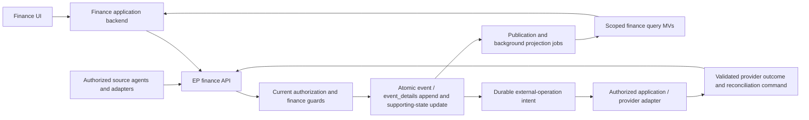

# System 2 Plan — Financial Control, Accounting and Settlement

## Purpose, references and numbering

Deliver the functionality described in [finance.md](finance.md), using the shared EP for governed changes and background-maintained materialized views (MVs) for routine queries. Finance and Partnerships is the accountable service owner; Digital Platform owns the shared platform contract and technical operation. Procurement, participant services, programme, food/retail and other portfolios remain responsible for the business activities that originate financial obligations.

**This is implementation plan 2, not a renumbering of the system catalogue.** In [prioritized_functions_systems.md](prioritized_functions_systems.md), this work primarily delivers **system 13 — Billing and accounting integration**, whose initial financial-control slice is P0, and subsequently **system 12 — Closed-loop payments and occasion finance**, whose operational acceptance is P2. Catalogue system 2 remains Participant registration and safeguarding. The build order means first useful delivery, not finishing every earlier product before finance can start.

The plan follows [organization.md](organization.md), [system_1_plan.md](system_1_plan.md), [suggested-data-store.md](suggested-data-store.md), [architecture.md](architecture.md), [gdpr.md](gdpr.md) and [monitoring_plan.md](monitoring_plan.md). Existing EP/TOM functionality and local monitoring provide reusable foundations; they do not establish that finance, the full authorization model, vendor acceptance or production recovery is already implemented.

## Outcomes and scope

| Capability | Planned outcome | Delivery emphasis |
|---|---|---|
| Books and chart of accounts | Nested accounting contexts, accounts, periods, categories, tags, posting rules and report mappings | P0 foundation; incremental CoA editor is the first operational UI. |
| Financial control | Versioned budgets, cost centers, work-package references, delegated limits, approvals and protected commitments | P0 before material commitments; extend forecasts and allocation as planning feeds arrive. |
| Daily bookkeeping | Manual/imported draft journals, documents/OCR suggestions, validation, approval and balanced posting | Initial controlled journal slice, then P1 source-system feeds. |
| Receivables and payables | Invoices, supplier obligations, reimbursements, credits, due dates and residual amounts | P1 as participant, supplier and sponsor workflows become available. |
| Open items and settlement | Partial/many-to-many allocation, unapplied payments, differences, disputes, reversals and write-offs | Prove partial settlement in the first vertical slice; broaden operational workflows later. |
| Reconciliation and external accounting | Bank/statement matching, authority-aware posting export, outcome reconciliation and audit references | Minimal agreed accounting interface in P0; additional adapters in P1/P2. |
| Reporting and consolidation | Finance, journal and open-item dashboards; budgets/actuals; nested-book consolidation and traceable adjustments | Initial MVs with each slice; cross-book consolidation after single-book reconciliation is proven. |
| Occasion payments | Financial account/credential separation, top-ups, purchases, refunds, limits, transfers and settlement | Early interface/hardware discovery in P1; controlled P2 implementation before trading rehearsal. |

This plan covers the financial consequences of procurement, stock, participant billing and kiosk activity. It does not replace supplier sourcing/order fulfillment (10), inventory (11), CRM (4), registration (2), workforce (3), documents (19), general WorkItems (5), communications (8) or the platform (21). Payroll-like reimbursements/settlements are included where specified; a complete payroll engine, unrestricted bank connectivity and a new tax-compliance product are not implied. OCR and agents propose values; they do not silently approve, pay or post them.

## Adopted architecture and application boundary

- Extend EP with finance domain command handlers, event schemas, synchronous guards, publication and query endpoints. Reuse its identity references, command receipts, stream versions, outbox/inbox, worker controls and scoped monitoring rather than building a second event store.
- Provide a separate finance web application/backend using EP APIs. Its ordinary business state has no independently authoritative local database. Unsaved editor drafts and bounded transport buffers are distinct from accepted financial records. VERA is the separate Rails/Tailwind/Phlex/Turbo client in `systems/vera`. Its initial scaffold is in place; authentication and tenant-book functionality are the next delivery slice.
- Browsers communicate with the application backend. Backends authenticate themselves and preserve the authenticated operator, represented identity and valid delegation; machines have explicit restricted credentials. Backend authentication alone grants neither arbitrary book access nor spending authority.
- EP owns financial acceptance and durable intent. Application/integration backends own provider credentials, delivery and external execution through an explicit API handoff. Persist operation IDs and acknowledgments in EP; never use a shared database/file mailbox as the application contract. A future MCP interface must expose the same governed operations.
- Query MVs are background-maintained in near real time, not sources of truth. Important acceptance checks use current, transactionally protected state. Reporting or projection replay cannot execute a payment, resend an invoice or export a posting as new work.

## Books and nested context

A book owns its accounting setup, chart, periods and postings. Model books using one common structure, including `tenant_id`, stable `book_id`, optional `parent_book_id`, name, lifecycle status, base currency, accounting calendar/timezone, authority mode and configuration version. All levels use the same tables, associations, commands and event protocol. A consolidated parent is an ordinary book context, not a separate implementation or table family.

An occasion references its applicable book. Several occasions can share one book, or SL2026 and SL2030 can own sibling books beneath a consolidated parent. Occasion-owned records retain `occasion_id`; genuine shared and consolidation work has explicit tenant/book scope without inventing an occasion. Parent links are tenant-local, acyclic and versioned. Validate hierarchy changes transactionally against concurrent moves; serialize only the affected tenant's hierarchy/configuration changes, not all financial postings.

Accounts belong to one book and have stable IDs independent of number and position. Preserve the finance.md convention: allocate the initial `AccountCreated` event ID as the stable account reference; subsequent events retain that reference and get separate event IDs. Validate every account, journal, period, party, document and dimension reference against its book/tenant and permitted occasion scope. Book IDs and event IDs are references, never access credentials.

A posting belongs to exactly one book. Cross-occasion allocation within a book changes explicit dimensions; cross-book movement has linked, separately balanced entries in the affected books. Failure/retry handling must expose incomplete linked operations rather than present half a transfer as complete. Each leg remains idempotent and subject to that book's authority; external-authority books cannot be included in an assumed local atomic transaction.

Consolidation selects child books and maps their accounts into the parent's reporting structure. A consolidation run pins the hierarchy, report/mapping versions, included periods, source checkpoints and any currency-translation/rounding policy. Traverse source postings once: never add both a child's consolidated total and its underlying postings. Parent-owned postings and eliminations are included once and distinguishable from child activity. Prior consolidation results remain reproducible against their recorded inputs; changing parentage or mappings does not silently restate a released report.

Consolidation adjustments/eliminations use the same journal/posting model in the parent's book. They do not rewrite child postings. The UI provides authorized source drill-down, unreconciled differences and mapping exceptions. Currency or period differences without an approved conversion/alignment rule block a final consolidated report rather than yield a plausible but unsupported total.

## Accounting authority, periods and money

For every book, choose exactly one authority for posted accounting:

| Mode | Accepted local meaning | External meaning |
|---|---|---|
| EP-authoritative | `JournalPosted` is the authoritative local posting and updates protected ledger/subledger state atomically. | Export is a replication/reporting operation, deduplicated by stable posting ID. |
| External-authoritative | Draft/submission/approval prepares an external posting request. Do not label it posted until validated external acceptance is recorded. | External ledger owns the posting reference and corrections; EP records observed authoritative results and reconciliation status. |

Local control of budgets/commitments can coexist with an external ledger, provided each object/field has an explicit owner. Authority-mode changes require a reviewed migration, opening balances, deduplication and reconciliation; they are not an ordinary settings toggle while either system continues writing.

Use fixed-precision decimals or currency-aware integer units; never binary floating point. Configure book currency, supported transaction currencies, exchange-rate provenance, rounding and permitted differences before posting in those currencies. Distinguish document date, posting date, due date, effective configuration date and server acceptance timestamp. Date-only accounting fields use the book calendar/timezone; transport/audit instants use explicit UTC timestamps.

Periods have governed open/closed transitions. Posting and closure contend on protected current period state, so a concurrent close cannot admit a late posting unnoticed. Reopening requires specific authority and a reason. Posted monetary entries are immutable; correction uses a referenced reversal/adjustment and replacement where needed. Number allocation, uniqueness and any gap policy must be documented before production activation.

## Authorization and financial controls

System 1 supplies current identity, grants and delegations; finance applies book, occasion, cost-center, action and amount/policy constraints. Technical tenant or platform administration does not itself confer journal approval, payment execution or access to every financial document. Nesting does not automatically grant access to child detail or consolidated results.

| Responsibility | Allowed work under adopted limits | Required separation |
|---|---|---|
| Finance configuration steward | Books/CoA, rules, periods, mappings and controlled imports | No automatic payment authority from maintaining setup. |
| Budget holder/requester | Budgets, requests and commitments in assigned scope | Approval follows the adopted policy and cannot be manufactured by changing scope. |
| Bookkeeper/source agent | Draft entry, document attachment, coding and submission | Cannot mark a draft approved/posted merely by originating it. |
| Financial approver | Approve a specific content revision within limits | Material changes invalidate approval; own-origin approval is blocked where policy requires separation. |
| Payment preparer / approver / executor | Prepare, approve or execute explicit operation revisions | Enforce configured separation and limits server-side; no generic UI override. |
| Reconciler/auditor | Authorized matching, reconciliation, history and reports | Independent reconciliation where required; read access does not confer mutation authority. |
| Consolidation controller | Mappings, consolidation runs and parent adjustments | Specific parent/child/result permissions; released results retain their approved basis. |

Adopt namespace-qualified permissions such as `finance.book.manage`, `finance.account.manage`, `finance.journal.submit`, `finance.journal.approve`, `finance.journal.post`, `finance.period.close`, `finance.payment.prepare`, `finance.payment.approve`, `finance.payment.execute`, `finance.settlement.allocate`, `finance.approval.override` and `finance.consolidation.run`. Freeze the exact vocabulary and amount/delegation policy with Finance before the first live write; names alone confer no scope.

Budget approval creates a versioned baseline. Accept commitments under the approved budget/limit policy using protected reservations/current state where overspend is prohibited. Actuals, commitments and forecasts are distinct: releasing/converting a commitment when its invoice posts must not double-count the same obligation as both a full commitment and a new actual. Budget transfers, revised baselines, write-offs, refunds and exceptional approvals record their scope, reason and approving revision. An allowed over-budget exception is an explicit policy decision, not an MV race.

## Persistence and event contracts

The EP transaction appends accepted facts and updates only the supporting state needed to enforce current invariants. Supporting state is a constrained representation of those facts and has a documented rebuild/verification procedure; no manual SQL correction creates an accepted finance fact. Large documents, bank files, OCR output and restricted narratives live in controlled artifact storage, with opaque version/integrity references in events.

| Domain | Representative accepted events | Synchronous supporting responsibility | Routine query representation |
|---|---|---|---|
| Books/hierarchy/periods | `BookCreated`, `BookRevised`, `BookParentChanged`, `PeriodOpened`, `PeriodClosed` | Scope, current hierarchy/version, authority mode, calendar and period guards | Book tree, setup and close checklist |
| CoA and configuration | `AccountCreated`, `AccountRevised`, `AccountMoved`, `AccountDeactivated`, `AccountReactivated`; versioned association/rule/report changes | Stable ID, reserved account numbers, current eligible version, order and formula/reference validity | CoA list/details, classifications, rules and mappings |
| Budget/control | `BudgetVersionCreated`, `BudgetApproved`, `CommitmentAccepted`, `CommitmentReleased`, `CostAllocated` | Approval revisions, delegated limits and reservations where enforced | Budget/forecast/commitment versus actual |
| Journals/approvals | `JournalCreated`, `JournalLineAdded`, `JournalLineRevised`, `JournalLineRemoved`, `JournalSubmitted`, `JournalApproved`, `JournalRejected`, `ApprovalOverridden` | Current journal/line revision and approved content/policy revision | Journal editor, review queue, validation/status counts |
| Posting/correction | `JournalPosted`, `PostingReversed`; linked replacement/adjustment facts | Posting/source uniqueness, balanced complete entry set, numbering and period/account guards | Ledger, trial balance, financial statements, account/period balances |
| Open items/settlement | `OpenItemEstablished`, `PaymentRecorded`, `SettlementAllocated`, `SettlementAllocationReversed`, `CreditApplied`, `WriteOffPosted` | Residuals, allocation links, currency rules and concurrent settlement guards | Receivables/payables, aging, unapplied funds and reconciliation |
| Payment preparation/execution | `PaymentProposed`, `PaymentApproved`, `PaymentInstructionSubmitted`, `PaymentExecutionConfirmed`, `PaymentExecutionFailed`; explicit unknown outcomes | Operation/attempt IDs, approved revision, external keys and reconciliation evidence | Payment queue and execution/settlement status |
| Documents/integrations/imports | `OpenItemAnnotated`, `FinanceImportAccepted`, `ReconciliationMatchAccepted`, `ExternalPostingConfirmed`; validated rejection/conflict outcomes | Artifact access, source/version deduplication, external mappings and inbox/operation state | Import preview/exceptions, matches, adapter drift and audit |
| Consolidation | `ConsolidationDefinitionRevised`, `ConsolidationRunAccepted`, `ConsolidationReportReleased`; ordinary parent-book adjustment postings | Definition/run version, pinned source manifest, release approval | Consolidated statements, eliminations and source lineage |
| Occasion payments | Accepted top-up, sale, transfer, refund, credential-change and settlement facts | Balanced ledger, protected available funds/limits, payment/reader deduplication and credential lifecycle | Account/merchant balances, exceptions and reconciliation |

The names above are proposed domain vocabulary to register in EP, not assertions that endpoints/events already exist. Avoid a single global finance stream: use stable book/setup, account, budget, journal, settlement and operation streams, with narrowly scoped cross-stream locks/transactions where an invariant spans objects. Use a deterministic locking order for multi-item allocations and transfers.

Every accepted finance event records schema version, tenant/book/occasion scope as applicable, aggregate/stream version, actual actor and verified delegation, command ID, correlation/causation and source provenance. Its typed details include relevant currency/amount, effective/posting dates, configuration versions and artifact/external references. Reject raw credentials and arbitrary callback/form payloads. Command rejection is not a successful accounting event; safe operational rejection evidence belongs to the monitoring/audit contract.

Reuse command idempotency and external source deduplication separately. The same command key with different content conflicts; repeated identical commands return the accepted receipt. The same external object/version cannot post again under a new local request key. Concurrent source imports must protect this in acceptance state, not only in the import MV.

## Core workflows

### 1. Book setup and CoA

An authorized steward creates/selects a book, chooses accounting authority, currency/calendar, applicable occasion bindings and periods, and configures the initial chart and policies. An authorized parent/child mapping establishes consolidation context without cloning the underlying records. Account numbers remain strings, including leading zeroes; posting rows, headings and totals are different types.

Deliver CSV template → column mapping → validation/change preview → atomic acceptance → projected result. Match by stable account ID where supplied, otherwise scoped book/account number. Missing CSV rows never imply deletion; validate uniqueness, scope, retired-number reservation, formula cycles and current versions again at acceptance. Exports identify their scope and source cutoff. Bulk tag/category/lifecycle/order changes are explicit, version-checked batches.

### 2. Budgets and commitments

Create a draft budget by book, occasion, cost center and work package; approve a version with delegated limits. Requests/orders/agreements reference the correct budget and obligation. Accept a financial commitment before the responsible source system treats spending as authorized. Record approval, reservation, release, cancellation and conversion to actual with stable source references. Forecast revisions remain distinguishable from the approved baseline.

### 3. Journal entry, approval and posting

Manual entry, OCR and approved source-system imports create draft lines. Support multi-leg transactions, supporting documents, tax/default suggestions, dimensions and accounting dates. Validate the current draft, submit it, and approve a specific content revision. Material changes invalidate the approval.

`PostJournal` rechecks current authority, approval, period, accounts, dimensions and effective tax/rule versions. Validate exact balance in book currency, explicit currency/rounding treatment and unique posting/source IDs. Atomically record the complete posting set, current journal/posting state, affected subledger state and publication intent. A crash produces either that accepted result or no partial posting. In external-authoritative mode use the external submission/confirmation workflow instead of manufacturing a local authoritative `JournalPosted`.

### 4. Receivables, payables and payment operations

Establish obligations from participant/sponsor/customer billing, supplier invoices, reimbursement claims and other authorized sources. Reuse canonical party references without copying full identity profiles into ledger facts. Capture original amount/currency, dates, terms, document references and source authority. Invoice numbering/delivery and external ownership follow the adopted mode; delivery acceptance is not receipt of funds.

Keep separate receipt/sending, approval, dispute, execution and settlement states. Preparing or approving a payment does not settle an invoice. Persist a durable operation intent, hand it to the authorized executor, and validate provider acceptance and final outcomes. For ambiguous submission, reconcile the same operation/key before considering a retry. Bank credentials and sensitive execution material are not ordinary event/MV fields.

### 5. Open items, adjustments and reconciliation

Allocate payments/credits against one or more obligations, including partial amounts and unapplied residuals. For example, allocations of 600 and 400 can settle an invoice of 1,000; two concurrent requests cannot each consume the final 400. Lock/revalidate all affected residuals, currency rules and versions, and commit the allocation changes together. Matching an already posted payment must not post cash a second time.

Bank, account-statement and OCR jobs produce suggestions from authorized MVs/artifacts. Accepting a suggestion is a governed command. Record differences, disputes, credits, approved write-offs and payment reversals explicitly. Reversing a settlement allocation does not resend/refund money; any real refund is a separate approved financial operation. Preserve links between corrections and their original postings/allocations.

### 6. Reporting, close and consolidation

Reconcile ledger/subledger/control accounts, external authority and bank evidence before releasing the applicable period reports. Close periods through current guarded state, not a dashboard checkbox. Consolidate the selected book tree at recorded source cutoffs, align mappings/currencies/periods, post authorized parent-level eliminations and release the result with its manifest. Surface missing mappings, incomplete child close, stale views and unreconciled differences rather than treating them as zero.

### 7. Closed-loop occasion payments

Keep the financial account separate from the wristband/card/device credential and canonical identity. Replacing a credential revokes the old one without creating money or duplicating the account. Protect available funds, approved overdraft/limits, merchant attribution, top-ups, purchases, transfers, refunds and settlement with balanced, idempotent ledger operations. Tie resulting accounting exports/postings to those same source operations, preventing a second revenue/cash posting during reconciliation.

Hardware and offline behavior require a distinct P2 acceptance gate. Default to online authorization until a bounded offline protocol has defined device identities, signed operations, counters/replay protection, offline limits/reservations, reconciliation and loss handling. An offline cached MV balance cannot independently authorize unlimited spending. No live trading begins before payment/refund/replacement/end-of-day settlement rehearsals pass.

## API and integration contract

Proposed roots are `/api/v1/tenants/:tenant_id/finance/books` and `/api/v1/tenants/:tenant_id/finance/books/:book_id/...`. Occasion-specific resources carry a verified occasion binding; an occasion-scoped application cannot widen itself to a whole book or its siblings by supplying a different route/body ID. Parent consolidation is a separately authorized operation with an approved source set and result audience.

| Surface | Proposed operations |
|---|---|
| Book/setup | Create/revise/list books; link occasions; change hierarchy; configure/close/reopen periods; inspect authority/configuration history |
| CoA | List/detail/create/revise/move accounts; lifecycle actions; tag/rule/report associations; preview/accept imports and export approved snapshots |
| Control | Draft/approve budgets; reserve/release/convert commitments; validate delegated limits and list exceptions |
| Journals | Draft line commands; validate/submit/approve/reject/post; reverse/adjust; inspect accepted posting and original documents |
| Open items | Query obligations/residuals; annotate; propose/accept/reverse allocations; apply credits and approved write-offs |
| External execution | Claim scoped operation intents with bounded leases; record bound attempt outcomes; ingest authenticated callbacks and reconciliation evidence |
| Reporting | Query MVs/freshness; request a report/consolidation run; inspect source manifest; release/download a scoped artifact |
| Payments | Account/credential operations, top-up/sale/refund/transfer commands, scoped device ingestion and settlement |

Publish OpenAPI schemas and fixtures before each slice's client/adapter build. Mutations carry an idempotency key and expected aggregate/configuration versions where relevant. Successful responses include command/event IDs, accepted version, status and the authorized result reference; command acceptance is separate from projected readiness and external execution. Support private receipt reconciliation by command ID or original command type/key. Version conflict, validation rejection, lost authority and unavailable/stopped query state have distinct safe responses; transport failure never proves rollback.

External callbacks authenticate their source and attempt binding and are deduplicated; they do not directly mutate a balance or confer permissions. A worker lease is not evidence a payment happened. Expired/ambiguous execution claims enter reconciliation, not blind redispatch. Application 21 registry bindings restrict tenant/occasion/book purposes and fields, with independent credentials and adapters for third-party applications.

## UI plan

Use a persistent tenant/book breadcrumb, applicable occasion/dimension context, current role and freshness state. Show the book tree with explicit **This book** versus **Consolidated scope**, included children and reporting cutoff. A parent result must never resemble an unrestricted list of all tenant transactions.

| Screen | Main interactions and feedback |
|---|---|
| Finance home | Finance balances by assets/liabilities/equity/stock, using appropriate labeled charts plus exact values; approved budget/commitment/actual and reconciliation exceptions. Clearly label dates, currency and scope; never imply all figures share a cutoff when they do not. |
| CoA line editor | Number/name/type/status and canonical order; Enter/Edit, Tab, Save/Cancel, add row, accessible move controls, search/filter, import/export and related-details panel. Preserve the full finance.md conflict layout: user draft plus newer accepted row below it, actor/application/version and explicit compare/reapply. |
| Budget/control | Baseline versus revisions, commitments and actuals by dimension; delegated-limit/exception explanations, approval and source drill-down. |
| Journals | Lines and draft validation, multi-leg detail, documents/OCR suggestions, configurable new-row placement, date/number defaults, displayed balances in header/footer, debit/credit/VAT/tax coding and submit/approve/post controls. Agents' suggestions remain visibly provisional. |
| Journal overview | Count lines/batches by draft, submitted, approved, posted and error states; links to the exact affected work. |
| Open items | Debtor/creditor, original/residual amount, invoice age, due/overdue age and separate approval/dispute/execution/settlement indicators. Search, annotate, partial allocation, credit, payment proposal and authorized override with reason. |
| Reconciliation | Bank/statement import, candidate comparisons, selected allocation preview, residual/difference explanations and explicit acceptance; no automatic cash posting from a match. |
| Payment operations | Approved instructions, attempts/provider evidence, unknown outcomes and reconciliation work; separate prepare/approve/execute controls. |
| Close/consolidation | Book tree selection, periods/currency/mappings, validation exceptions, adjustment journals, pinned source manifest, release and traceable report drill-down. |
| Occasion payments | Authorized account/credential view, balance/limits, sales/top-ups/refunds, replacement, reader/offline status and settlement exceptions. |

Stream accepted versioned updates into the existing page through Turbo/LiveView-equivalent behavior. Preserve safe unsaved input, focus and selection; do not navigate to a generic error page. Optimistic saves show Saving → Accepted/updating view → projected version. Distinguish conflicts from validation failures and unknown outcomes. Disable duplicate submission while reconciling an ambiguous command; never automatically repeat payment or posting actions. A stopped MV is unavailable, not a current successful view. Revoked access removes protected data.

Use text as well as color, accessible keyboard/touch alternatives, mobile stacked rows/details and explicit empty/filtered/forbidden/unavailable states. Document downloads are authorized and expiring. No sensitive full bank/payment/identity detail appears in general dashboards or monitoring.

## MVs, publication and operational controls

| Projection family | Trigger / consistency responsibility |
|---|---|
| `book_tree`, `chart_of_accounts` and related configuration views | Accepted setup/account/association changes; include configuration and account/order versions. |
| `journal_current`, `journal_status_counts` | Draft/approval/posting changes; expose accepted versus projected revision and actionable errors. |
| `ledger_by_account_period`, `financial_statement_balances` | Apply complete posting sets atomically, including reversals; preserve source/configuration lineage. |
| `open_items_current`, `open_item_aging`, `payment_queue` | Accepted obligation/payment/allocation/execution events; schedule date-driven aging even without new events. |
| `bank_match_candidates`, integration/reconciliation views | Controlled source ingestion and rule revisions; suggestions never become allocations on their own. |
| `budget_actual_commitment` | Approved baselines and commitment/actual conversion; preserve distinct forecast and reservation measures. |
| Consolidation runs/results | Hierarchy/mapping/report versions and explicit source manifests, including parent adjustments; invalidate/recompute only affected results and preserve released artifacts. |
| Occasion account/merchant/settlement views | Complete balanced payment operations and validated execution outcomes; cached balances never authorize debits. |

Reuse tenant-admin queue/job/MV binding, stop and token controls. Book/occasion restrictions remain enforced in workers and serving, and a tenant-level queue is not permission to mix data. Record checkpoints and rebuild generation; ignore duplicates/stale revisions and quarantine gaps or invalid contracts. Multi-stream reports pin an explicit checkpoint manifest rather than assume unrelated stream versions are comparable. Side-effect dispatch is separate from projection work and never runs in rebuild mode.

Track ingestion/acceptance failures, rejected posting/settlement invariants, queue age, projection lag, configuration conflicts, external unknown outcomes, reconciliation drift and retention/restore exceptions through the monitoring protocol. Register finance UI, integration and device sources with approved scoped credentials. Operational issue acknowledgment does not resolve the underlying financial obligation or unknown payment. Source evidence and financial follow-up remain linked but independently governed.

## Privacy, retention, artifacts and recovery

Apply gdpr.md to identity references, counterparty/payment details, notes, receipts, OCR, exports, MVs, external mappings, transport buffers and backups. Restrict document and payment evidence by purpose; do not propagate raw contact profiles, bank secrets or purchase narratives to all consumers. Treat pseudonymous account/identity IDs as potentially identifying, not automatically anonymous.

Finance owns a documented retention/hold decision for required accounting evidence, independent of routine occasion expiration or optional prolonged-retention consent. Minimize or erase unrelated contact/content data, restrict any justified retained evidence and record the basis/expiry decision. A deletion request must not silently invalidate balanced accounting; nor does preservation of accounting facts justify retaining every attached personal detail. Opt-in alone does not authorize indefinite retention.

Maintain subject/artifact indexes and suppression markers across events, current state, projections, reports and provider copies. Rebuild and late ingestion honor current redaction/suppression policies. Restores stay unpublished and external executors disabled until the latest ledger and every finance-domain erasure/hold handler are applied and verified. General/local monitoring backup cleanup is not a finance erasure implementation. Offline/original/immutable backup tasks require custodian evidence; replacing a copy does not prove the original is gone. See [pending_details.md](pending_details.md) for unresolved deployment obligations.

Recovery compares accepted postings, protected state and MVs at a common source manifest; mismatches stop the affected financial operation for investigation. Rebuild query views into a new generation and verify totals/residuals before serving. Never repair a monetary difference by editing a projection. Restoring code/data must not restore revoked credentials, rerun provider execution or convert an unknown external outcome into failure/success without evidence.

## Delivery packages and priority gates

Work starts with Finance's P0 charter, budget/approval policies and the necessary slices of identity (1), platform (21), documents (19), WorkItems (5), reporting (20) and communications (8). Use existing accepted tools where a platform dependency is unfinished; do not bypass the financial controls to open live workflows. Detailed dates/effort follow team and adapter discovery, not the priority labels alone.

| Order / wave | Package and first useful result | Dependencies | Acceptance gate |
|---|---|---|---|
| 0 / P0 | Contract, scope and accounting-owner baseline; map existing books/tools; adopt financial mandates and first budget/limits; inspect vendor/hardware interfaces | Finance and Digital owners, system 1/21 contracts and existing accounting process | Named authority for each book; approved roles, currency/calendar, separation, retention and source ownership; real workflows can be controlled before custom UI exists. |
| 1 / P0 | Finance EP foundation and CoA UI: one tenant/book, setup/periods, account/rule/history/import/export, scoped queries and source registration | Package 0; minimum current authorization, artifacts and EP publication/receipts | Concurrent account-number/order/configuration races rejected; CoA line editing, CSV preview, optimistic conflict recovery and near-real-time MV catch-up work. Nested-book model is supported from the outset. |
| 2 / P0 | Budget and commitment control, financial approvals and minimal accounting interface | Package 1; Finance policy and existing ledger interface | Budget holder can obtain a scoped mandate; commitments cannot bypass limits or be double-counted; approved export/import/reference workflow reconciles with the designated authority. Required before material commitments. |
| 3 / P0 → P1 | First end-to-end accounting slice: one journal, multi-leg posting, one receivable/payable and partial settlement, incremental reports | Packages 1–2 and controlled documents; EP-authoritative test book or accepted external-authority test adapter | Draft → approved revision → posting/confirmed external result → residual 600/400 allocation → ledger/open-item reconciliation; duplicate/crash/concurrency tests pass. No live bank execution required to prove this slice. |
| 4 / P1 | Operational receivables/payables, source imports, reimbursement/credit/write-off flows, bank/statement matching and accounting adapter reconciliation | Package 3; systems 2/3/4/10/11 as their financial feeds become necessary, not their whole products | Source objects cannot post twice; imports stay proposed until accepted; matching never posts cash twice; exceptions have owners and safe delivery/execution evidence. |
| 5 / P1 | Nested-book close/consolidation and cross-book transfers; report release, mappings, eliminations and forecasts | Proven single-book reconciliation; representative sibling/parent books and approved currency/period policy | No hierarchy cycle/cross-tenant link, double-counting or authority leak; source manifests reproduce results; parent adjustments leave children unchanged. |
| 6 / P2 | Authorized provider payment execution and operational settlement; device/closed-loop payment slice with financial-account/credential separation | Packages 3–4; provider contracts, system 16 credential interface, kiosk/source requirements and approved hardware protocol | Unknown outcomes reconcile without duplicate funds movement; refund/replacement/limits/settlement pass; any offline mode has its own signed, bounded protocol and tests. Ready before trading rehearsal. |
| 7 / P2 → P3 | Capacity/failure/rights/restore rehearsal, pilot, controlled cutover and closure handover | Each deployed package and named operational/custodian owners | Financial control totals, isolation, reconciliation, backup/domain erasure and no-side-effect replay proven; representative duties/support cover build, live trading and post-occasion closure. |

Packages 4–5 can overlap after their prerequisites pass; provider/device discovery starts in package 0/P1 so incompatibilities are found early. Package 6 is not a prerequisite to offering budget, CoA or bookkeeping. Safety, procurement and recruitment deadlines can bring forward a required interface without inventing a second source of truth.

## Verification and release criteria

Use at least two tenants and, in one tenant, a parent book with two occasion books plus a shared-cost book. Test real API boundaries and guarded transactions, not only projection functions.

1. Substitute tenant/book/occasion/account IDs in routes, bodies, tokens, exports, worker jobs and consolidation manifests; reject unauthorized references and prevent parent access from implying child access.
2. Race account creation/number reuse, account deactivation versus posting, concurrent hierarchy moves and period closure versus posting. Reject invalid outcomes without partial facts/state.
3. Exercise the CoA keyboard/touch editor, late/duplicate streams, dirty-row comparison, failed validation, lost response reconciliation, stopped MV and revoked access. CSV import preserves leading zeroes, rejects bad/cyclic references and replays once.
4. Change a submitted/approved journal or approval limit before posting; require current approval and policy. Simultaneous posting/retries produce one immutable balanced set and one numbering/source reference.
5. Race two allocations against the same residual; prevent over-settlement. Test partial/multiple invoice/payment/credit allocations, unapplied funds, differences, dispute, reversal and write-off. No match/reversal automatically moves money twice.
6. Race commitments against remaining budget and convert committed to actual; verify enforced limits and no double count. Overrides require adopted authority, recorded reason and the affected content revision.
7. Crash before/after acceptance, publication, provider handoff and callback. Reconcile unknowns by stable operation/key; duplicate/out-of-order callbacks and replay cannot charge, pay, invoice or export again.
8. Consolidate multiple levels with parent-owned adjustments, account remapping and differing periods/currencies. Verify unique source inclusion, approved conversion, frozen released results and restricted source/result audiences.
9. Replace/revoke a wristband while purchases/refunds run; funds remain in the same account and old credentials fail. Exercise offline replay/limits if enabled, including eventual reconciliation and known loss boundaries.
10. Compare authoritative postings/reservations/residuals with all financial MVs at pinned checkpoints, including delayed jobs and atomic posting-set publication. A projection failure cannot authorize extra spending or silently zero a report.
11. Erase/minimize a subject's eligible data while preserving justified balanced evidence; verify artifacts, finance projections, reports, vendors, late backlog and isolated restore under applicable holds. Rebuild sends no external instructions.
12. Rehearse import/opening balances, reconciliation and cutover with a representative Finance team. Check desktop/mobile accessibility and failure recovery in Playwright, plus independent operational monitoring and restoration evidence.

Safety criteria are mandatory: zero accepted unbalanced/duplicate postings, unauthorized cross-scope actions or over-settlement in verification. Measure command latency, MV lag, query/export behavior and external reconciliation time under a representative request mix. A provisional local target is p95 under one second for ordinary commands and five seconds for MV catch-up in a healthy test setup; Finance/Digital must adopt measured production objectives before rollout. No 40–80,000-concurrent-user claim follows from the existing monitoring smoke test or these provisional targets.

## Rollout, ownership and decisions before activation

Pilot with a synthetic tenant/book and fake providers, then a limited Finance team and an explicitly chosen authority mode. Import a reviewed chart, opening balances/open items and external references at an agreed cutoff. Reconcile counts, balance and residual control totals, then explicitly switch write ownership; parallel comparison may read both systems but must not leave competing writers. Roll out further books/occasions/integrations by accepted package.

Containment can stop an adapter/device/source or affected book operation while retaining accepted history and access-controlled evidence. Revoking future execution does not prove an in-flight provider instruction failed; keep it in reconciliation. Assign post-occasion owners for outstanding receivables/payables, funds/refunds, period close, final consolidation, artifacts and retention. Book closure and occasion retirement are separate transitions.

| Decision / evidence | Accountable owner | Needed before |
|---|---|---|
| Actual book hierarchy, occasion bindings, ledger authority and any migration/opening balances | Finance lead and accounting owner | Package 0 completion / first live book |
| Chart template, reserved numbering, periods, currency/rates, VAT/tax and rounding configuration | Finance accounting steward | First posting in the applicable configuration |
| Budget/approval/payment limits, separation, overrides and role/delegation vocabulary | Finance lead with system 1 policy owner | Live commitment, approval or payment activation |
| VERA deployment, API schema registration and required current system 1/21 capabilities | Digital Platform and Finance product owner | Scaffolding / package 1 acceptance |
| External accounting, bank/payment provider and document/delivery adapters; fields, credentials and source authority | Finance integration owner and Digital | Corresponding adapter/provider activation |
| Consolidation membership/mappings, conversion/alignment policy, release authority and audiences | Consolidation controller | First released consolidated result |
| Device/credential integration and whether bounded offline trade is required | Payment operations, Digital and security/access owner | Device purchase/protocol commitment and trading acceptance |
| Accounting-evidence retention/holds, rights handlers, vendor evidence and backup custodians | Finance controller/privacy and operational custodians | Personal-data processing and production restore/retention activation |
| Production objectives, capacity profile, on-call/reconciliation ownership and cutover/closure evidence | Finance service owner and Digital operations | Production acceptance / each operational extension |

These decisions are gates on the relevant capability, not reasons to stop the book/CoA and transaction-contract work. This document is a proposed implementation plan; it does not declare any finance capability built or approved for live money movement.
