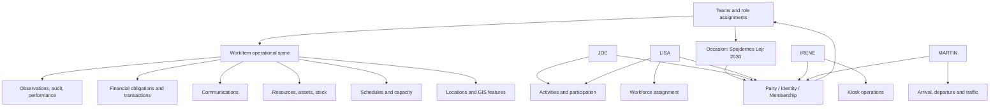

# Use cases

These use cases exercise the core model from [`entity-relationship.md`](entity-relationship.md) with four representative people at Spejdernes Lejr 2030. They are deliberately end-to-end: a person’s occasion participation is connected to teams, work, locations, schedules, resources, communications, safety, payments, and audit records.

## Personas

| Person | Occasion context | Participation and responsibilities |
|---|---|---|
| **JOE** | 11-year-old scout; first camp. | Participant in a patrol of six, within a troop containing four other patrols. His guardian, dietary/health information, consent, arrival, activities, payment account, and safeguarding context are important. |
| **LISA** | 16-year-old scout; third camp. | Has a dual occasion context: participant in her patrol and part-time volunteer hospitality hostess in an on-camp restaurant. Her participant and workforce records must remain related but separately authorized. |
| **IRENE** | 39-year-old; second camp. | Full-time volunteer responsible for a kiosk selling ice-creams and cold beverages. She needs staffing, stock, food-safety, cashless payment, replenishment, maintenance, and performance workflows. |
| **MARTIN** | 62-year-old; eighth camp. | Full-time volunteer responsible for all traffic logistics. He needs a broad operational role across arrivals, departures, routes, gates, vehicles, staging areas, dispatch, and traffic incidents. |

## Use-case map

## UC-01 — Create a safe occasion participation record for JOE

**Primary actors:** JOE, guardian, participant registration team

**Supporting spaces:** Identity and access; contacts and organizations; occasions and tenancy; memberships and teams; participant registration and safeguarding; CRM; data integration and platform services.

**Goal:** Create JOE’s occasion participation while preserving his identity, guardian relationship, consent, source provenance, and purpose-limited sensitive information.

### Main flow

1. A guardian or authorized registration worker finds or creates JOE’s canonical `Party` record. If JOE’s scout organization supplies a member record, the platform imports it with source identifier and provenance, then reconciles it against existing data.
2. The platform finds or creates JOE’s required `Identity`, regardless of whether interactive sign-in is enabled. JOE’s age and guardian relationship determine his direct access; a guardian authenticates as themselves, with explicit authority to act for JOE.
3. The platform creates JOE’s `Membership` in the occasion with participant status, first-camp context, and the applicable participant role.
4. Registration records JOE’s guardian as a `Relationship`, and stores consent, emergency contact, health, allergy, dietary, accessibility, and other required answers as purpose-limited records.
5. A `Participation` record is created for each selected `Activity`, subject to eligibility, capacity, and waitlist rules.
6. JOE is assigned to his patrol `Team`; the patrol is nested in his troop hierarchy. Team visibility and communication inherit only the permissions allowed by role and safeguarding policy.
7. An arrival/departure declaration is linked to his membership or group manifest, including accessibility and handover requirements if applicable.
8. The platform creates an occasion payment account and associates an RFID wristband later, without making the wristband the account itself.
9. Every import, consent decision, sensitive-data access, membership change, and team assignment produces an `AuditEvent`.

### Alternatives and exceptions

- If the external club record conflicts with guardian-provided information, the field-level trust and reconciliation policy determines whether the record is accepted, flagged for review, or retained as a separate value.
- If safeguarding information requires follow-up, a restricted `WorkItem` or `Incident` is created and visible only to authorized personnel.
- If an activity is full, the `Participation` enters a waitlist and capacity changes may automatically create a notification.

### Result

JOE is represented as one canonical `Party`, with occasion-scoped `Membership`, guardian relationship, patrol and troop relationships, controlled participation data, payment account, and auditable safeguarding context.

## UC-02 — Give JOE a first-camp experience through patrol and troop activities

**Primary actors:** JOE, patrol leader, troop leader, activity staff

**Supporting spaces:** Memberships and teams; occasions and activities management; calendar, scheduling, and capacity management; closed-loop communications; GIS; participant support.

**Goal:** Let JOE participate safely in activities while operational staff can see the correct team, location, capacity, and supervision context.

### Main flow

1. JOE or his guardian selects an `Activity`; the system checks membership eligibility, age, capacity, schedule conflicts, and any required consent.
2. The activity creates a `Participation` record and exposes the appropriate details to JOE, his guardian, patrol leaders, and authorized staff.
3. The `Activity` has a `ScheduleEntry`, `Location`, capacity, staffing `Assignment`, and linked approved `Document` such as safety guidance.
4. The patrol or troop receives a targeted `Communication` with meeting time, location, route, equipment list, and acknowledgement requirement.
5. At the activity, attendance is recorded against JOE’s participation. Late arrival, absence, or a support need can create a `ServiceRequest` or `Task`.
6. The map shows the activity location and any closures or route changes relevant to a supervised child.
7. Feedback and attendance become `PerformanceRecord` data at aggregate or appropriately protected individual level.

### Result

JOE’s participation is connected to team context, a scheduled activity, staffing and capacity, location, guidance, communications, attendance, and learning without exposing sensitive information to the whole troop.

## UC-03 — Handle LISA’s dual participant and volunteer identity

**Primary actors:** LISA, workforce coordinator, patrol leader, restaurant supervisor

**Supporting spaces:** Memberships and teams; volunteer and occasion workforce management; occasions and activities; scheduling; identity and authorization; safeguarding; communications.

**Goal:** Allow LISA to remain a scout in her patrol while working part-time as a hospitality hostess.

### Main flow

1. LISA has one canonical `Party`, one occasion `Membership`, and an authenticated `Identity`, but receives multiple `RoleAssignment` records: participant/scout and part-time hospitality volunteer.
2. Her patrol `Team` relationship remains active. A separate hospitality team or restaurant operational unit receives a second relationship with its own supervisor, location scope, and permissions.
3. Workforce management creates a volunteer profile, screening result, onboarding tasks, required training, and a part-time `Assignment` for restaurant hospitality.
4. Scheduling creates shifts with preparation and teardown periods. Capacity and conflict checks compare her restaurant shift with patrol activities, required rest, age restrictions, and travel time.
5. LISA receives the minimum necessary communications for each context. Patrol messages do not automatically expose restaurant operations, and restaurant messages do not expose her participant or safeguarding information.
6. During a shift, LISA can access hospitality procedures, menus, allergen guidance, incident reporting, and a scoped operational map. She can create a `ServiceRequest` or `Incident` if a guest needs help, a food-safety concern appears, or the restaurant is short-staffed.
7. The supervisor records attendance and handover. Volunteer wellbeing or safeguarding concerns are routed to authorized workforce personnel, not to the patrol.
8. Outside the shift, LISA returns to her participant context. Her activity participation, patrol communications, payment account, and volunteer assignment remain separate records linked through the same occasion membership.

### Important rule

LISA is not duplicated into two unrelated people. The platform uses one `Party` and one occasion `Membership` with multiple scoped roles, teams, assignments, and permissions. A module may maintain its own profile details, but the shared identity and occasion membership remain canonical.

## UC-04 — Operate IRENE’s kiosk from opening through close

**Primary actors:** IRENE, kiosk team, stock personnel, finance and food-safety staff

**Supporting spaces:** Workforce; stock and asset management; supply-chain; food-service and catering; environmental and food-safety monitoring; closed-loop payments; facilities and utilities; scheduling; GIS; ticketing.

**Goal:** Enable IRENE to run an ice-cream and cold-beverage kiosk with the right people, stock, equipment, food-safety controls, payment capability, and escalation paths.

### Pre-opening

1. IRENE’s `Party` and occasion `Membership` are linked to a full-time volunteer workforce record.
2. Her `Assignment` makes her responsible for the kiosk `Location`, for specified operating periods, and for a defined set of duties and escalation rights.
3. The kiosk is represented by a `GISFeature` and linked to a facility, serving point, cold-storage equipment, utilities, stock location, and capacity constraints.
4. A parent `WorkItem` represents kiosk readiness. Child `Task` records cover cleaning, temperature checks, stock receipt, equipment inspection, signage, and opening approval.
5. Demand planning creates a bill of materials and stock requirements for ice-creams, beverages, cups, napkins, refrigeration capacity, and cleaning supplies. `ResourceAllocation` reserves the required stock and equipment.
6. Deliveries are connected to `SupplierCommitment`, arrival slots, gate/staging locations, and receiving tasks. Variances create a shortage or quality `ServiceRequest`.
7. IRENE acknowledges the approved kiosk procedure, food-safety guidance, allergen information, emergency contacts, and payment operating procedure.

### During operations

1. IRENE records opening checks and temperature `Observation`s. Sensor readings or manual inspections retain source, unit, timestamp, quality, location, and threshold.
2. A threshold breach can automatically create a high-priority `WorkItem` or `Incident`, assign a food-safety or facilities team, and issue an authorized targeted `Communication`.
3. Customers use occasion payment accounts through a reader. Where connectivity is unavailable, the payment process uses the approved offline protocol with bounded balance, cryptographic protection, replay protection, and later reconciliation.
4. Every transaction links to the kiosk, reader, operator identity, occasion account, and audit trail. The wristband remains replaceable and is not the sole bearer of value.
5. Low stock creates a replenishment `Task` linked to stock, location, route, schedule, responsible team, and potentially a delivery. IRENE can see status without needing warehouse permissions.
6. A broken refrigerator creates a facilities `ServiceRequest` at the kiosk location. It can spawn a maintenance task, reserve a technician, issue a communication about unavailable products, and record lost stock as a possible `FinancialObligation`.
7. IRENE can report a customer support need or safety observation. Critical matters become restricted `Incident`s and follow the online-first incident-response path.

### Closing

1. Closing tasks reconcile sales, remaining stock, wastage, temperature records, cleaning, equipment condition, and handover.
2. Issued reusable assets produce return and inspection records. Missing or damaged items can link to an invoice or other charge decision.
3. `PerformanceRecord`s capture stockout rate, sales volume, waste, response times, uptime, safety compliance, volunteer workload, and satisfaction.

## UC-05 — Manage traffic logistics with MARTIN

**Primary actors:** MARTIN, traffic control team, arrival/departure coordinators, drivers, gate staff, dispatchers

**Supporting spaces:** Arrival and departure logistics; transport and traffic management; GIS-enabled camp planning and operations; scheduling and capacity; workforce; communications; ticketing; emergency and incident command.

**Goal:** Let MARTIN coordinate the occasion-wide movement of people, vehicles, goods, waste, and emergency access.

### Planning flow

1. MARTIN’s long experience is represented in his `Party`, occasion `Membership`, workforce profile, qualifications, training, and full-time traffic-management `RoleAssignment`.
2. A traffic operations plan is a parent `WorkItem` with child tasks for route planning, permits, gate readiness, parking, shuttle flows, supplier deliveries, waste collection, emergency access, and departure clearance.
3. The GIS model contains roads, gates, checkpoints, parking, staging areas, loading points, route restrictions, one-way flows, closures, and emergency corridors. Design versions are approved before operational publication.
4. `ScheduleEntry`s define arrival/departure slots and traffic-control shifts. `Capacity` records cover gates, roads, staging areas, parking, buses, shuttles, and loading zones.
5. Transport declarations link vehicles, drivers, manifests, destinations, access permissions, accessibility requirements, and expected throughput. Participant and group records contribute movement demand without exposing unnecessary participant data.
6. Supplier deliveries and stock movements are coordinated with delivery windows, route plans, loading/unloading tasks, and destination `Location`s.
7. Martin receives operational dashboards and communications appropriate to his role. He can see relevant incidents and closures, but not unrelated health, safeguarding, or payment data.

### Live arrival

1. A bus or supplier vehicle checks in at the assigned gate. Actual arrival is recorded against the planned `Movement`, manifest, slot, vehicle, and receiving team.
2. The system updates throughput and queue conditions. If capacity is exceeded, a traffic `Task` can redirect vehicles to staging or activate a contingency route.
3. A blocked road, failed vehicle, missing manifest, or unsafe pedestrian conflict creates a location-linked `ServiceRequest` or `Incident`.
4. Martin or a dispatcher assigns a traffic team and, where needed, a vehicle, barrier, signage, tow capability, or emergency resource through `ResourceAllocation`.
5. The dispatch system uses online access to signal first-response or traffic teams, maintain acknowledgements, and coordinate triage. A local offline note may preserve continuity, but it is not treated as confirmed dispatch.
6. Authorized communications publish route changes to affected drivers, teams, participants, or all participants depending on severity. The GIS operational layer reflects the closure and its validity period.

### Live departure

1. Departure movements are compared with actual loading, staging, gate passage, and route throughput.
2. Missing people or goods, overloaded capacity, or a delayed coach becomes a work item with affected party, location, priority, owner, and escalation.
3. Once the movement is complete, the system preserves planned versus actual timing and records performance, bottlenecks, incidents, and corrective actions.

## UC-06 — Coordinate a shared incident involving multiple personas

**Example:** A refrigeration failure at IRENE’s kiosk causes a product-safety concern during a congested arrival window managed by MARTIN; LISA is working nearby and JOE’s patrol is in the area.

**Primary actors:** kiosk staff, MARTIN or traffic dispatch, incident commander, first-response and food-safety teams

**Supporting spaces:** Occasion operations and support tickets; emergency and incident command; environmental and food-safety monitoring; facilities; GIS; communications; safeguarding; workforce.

### Main flow

1. An `Observation` shows an unsafe refrigerator temperature or a person reports a suspected food-safety issue. The system creates a restricted `Incident` at the kiosk `Location`.
2. The incident’s centrally governed lifecycle moves from reported to acknowledged and triaged. The incident module supplies its own semantics for food-safety classification, containment, investigation, and clearance.
3. Online dispatch signals the food-safety, facilities, and nearby response teams. The incident commander creates a response plan with child `Task`s: isolate stock, secure the area, inspect equipment, manage customer flow, document affected batches, and authorize reopening.
4. MARTIN receives a scoped traffic task if the kiosk queue or response vehicles affects a route, gate, or staging area. The GIS operational layer can show the restricted operational condition without publishing sensitive details.
5. LISA, if on shift, receives only the instructions required for her hospitality assignment. She may acknowledge a safety procedure or create an observation, but does not automatically gain incident-command access.
6. JOE’s patrol may receive a participant-safe route or service notification if needed. No health, safeguarding, or security details are disclosed to the patrol.
7. Communications retain delivery and acknowledgement records. Incident decisions, access, stock quarantine, equipment state, and financial consequences are audited.
8. Resolution requires verification, such as acceptable temperature, safe stock disposition, facility repair, and authorized reopening. The incident is then closed or linked to follow-up work.

### Result

One incident coordinates several teams and work items while preserving role-based visibility. The same `Location`, `GISFeature`, `Observation`, `Communication`, `ResourceAllocation`, `FinancialObligation`, `AuditEvent`, and `PerformanceRecord` references allow the occasion to be understood across modules without duplicating ownership.

## UC-07 — Replace a lost wristband without losing identity or funds

**Primary actors:** JOE or guardian, LISA, IRENE as payment operator, payment support staff

**Supporting spaces:** Identity and access; participant registration; closed-loop payments; security and access control; CRM; audit and integration.

1. A lost wristband is reported by JOE’s guardian, LISA, or an authorized operator. The report creates a security/service `WorkItem` linked to the membership and payment account.
2. The old wristband credential is revoked. The participant’s `Party`, `Identity`, `Membership`, and payment account remain unchanged.
3. A replacement wristband is associated after identity and authorization checks. If the account contains offline transactions not yet reconciled, the payment service applies its duplicate, replay, conflict, and risk rules before finalizing the balance.
4. Access-control and payment audit records show who revoked, replaced, approved, or adjusted the association. Any administrative adjustment becomes a compensating transaction rather than an edit to history.

## UC-08 — Offboard volunteers and close the occasion record

**Primary actors:** LISA, IRENE, MARTIN, workforce coordinators, team supervisors

**Supporting spaces:** Workforce; stock and asset management; security and access control; knowledge management; finance; performance and learning; GDPR/data governance.

1. Workforce management closes each volunteer `Assignment`, records attendance and completion, and captures appropriate satisfaction, wellbeing, and performance information.
2. LISA, IRENE, and MARTIN return reusable `StockUnit`s and equipment. Inspection results determine restock, maintenance, loss, damage, or charge handling.
3. Access grants, credentials, operational overrides, and device permissions are removed or expire according to the role and occasion lifecycle.
4. Outstanding child work items, incidents, financial obligations, supplier commitments, and unresolved tickets are handed over to named owners rather than silently closed.
5. The occasion produces aggregate `PerformanceRecord`s: participation, volunteer coverage, traffic throughput, kiosk availability, stockouts, incident response, satisfaction, costs, and lessons learned.
6. Sensitive records enter their documented GDPR retention schedule. Access, export, restriction, deletion, anonymization, and legal-hold actions are auditable and purpose-limited.
7. Approved runbooks, maps, procedures, and lessons learned are versioned in the knowledge system for the next camp without exposing personal data unnecessarily.

## Cross-person acceptance criteria

The examples imply the following platform behaviours:

- One person can have several occasion roles and team relationships without duplicate identities; LISA is the decisive test case.
- A child’s participation can be supervised through patrol and troop hierarchy while sensitive records remain purpose-limited; JOE is the decisive test case.
- A volunteer’s responsibility can span work, stock, food safety, facilities, payment, communications, and performance; IRENE is the decisive test case.
- A role can operate across many locations, schedules, movements, capacities, and incidents with live GIS dispatch; MARTIN is the decisive test case.
- Small tasks and major operational programmes use the same `WorkItem` spine, but module-specific state semantics remain available.
- Planned and actual schedules, arrivals, assignments, resource allocations, transactions, observations, and outcomes are both retained.
- Offline payment operation is bounded, cryptographically protected, and reconciled; incident response is online-first for dispatch, triage, and acknowledgement.
- Every sensitive access, external-party reconciliation, payment change, role transition, incident decision, and material operational change is auditable.

## UC-09 — Let multiple real users act through an organizational identity

**Primary actors:** organization administrator, two authorized real users, identity steward

1. Establish the organization as a `Party`; it may remain without an identity while relationships and contracts reference that contact.
2. If organizational identity access is needed, establish its optional `Identity` and at most one `Membership` per occasion. Each real user retains their own required human identity and personal occasion membership where applicable.
3. Grant each user an `IdentityUseDelegation` specifying the represented organizational identity, occasion, application, allowed actions, scope and validity.
4. Each user authenticates as themselves and selects the approved acting-as context. Evaluate current operator eligibility, delegation and organizational authority before acceptance.
5. Record both actual operator and represented organizational identity, plus delegation evidence, in accepted events and access audits. Adding a second operator does not create another organizational identity or membership.
6. Revoke one operator independently, preserving the other's valid access. Suspending the organizational identity blocks all its acting-as access; retiring its optional identity resolves dependent memberships and provisioning while preserving the organization contact and governed history.

**Result:** Organizational identity access can be shared among authorized real users while each action remains attributable and scoped. Human and mechanical/electronic contacts always retain their required identities, even when interactive login is disabled.

## UC-10 — Sign up, create a tenant, and launch occasion recruitment

**Primary actors:** individual identity or organizational identity acting through an authorized human operator; additional tenant admins; occasion admins

1. The actor signs up or authenticates with their existing identity. If representing an organization, validate the acting-as delegation and retain both operator and organizational identity.
2. As the first tenant action, submit `CreateTenant`. Atomically create the tenant, creator TenantAccess and tenant-wide `tenant_admin #1` grant; duplicate retries return the same accepted result.
3. The tenant admin may invite or grant additional tenant admins. Each receives tenant-wide administrative authority through a recorded, revocable grant; verification is required before an unregistered invitee can act.
4. A tenant admin creates an occasion within the tenant. The occasion receives its own ID and parent binding, independent of tenant ID.
5. A tenant admin opens recruitment explicitly. Applications for this occasion are now accepted by the recruitment intake under its rules; participant registration and applicant acceptance remain distinct workflows.
6. A tenant admin assigns occasion admins. Their default authority covers this occasion, not tenant-admin delegation or sibling occasions.
7. Every occasion data point carries its tenant and occasion context; recorded facts resolve **tenant > occasion > event**. Tenant-creation/admin facts are tenant-scoped, and global signup facts precede the tenant.
8. The same tenant may later create another occasion. LISA has one membership in SL2026 and another in SL2030, even when both are owned by this tenant. Her roles within either occasion share its single membership.

**Result:** Self-service establishes tenant authority before occasion participation exists. Tenant-wide administration, occasion administration, camp business appointments and organizational acting-as remain separate, traceable scopes.

## UC-11 — Invite and recover a user through scoped vouching

1. A user invites another into an existing or proposed new organization, directly or through a scoped signup slug.
2. The inviter's team lead vouches within their permitted scope; the invitee verifies email/phone by magic link before admission. Subsequent authentication can use magic links, six-digit email/SMS codes or OpenID Connect, never platform username/password.
3. If the user loses their phone, a higher-permission authorized voucher supplies a new phone/email; verify that channel and revoke obsolete bindings without changing the canonical identity or granting new roles.
4. Organization retirement retires its users' assigned access in that organization; unrelated memberships remain governed separately.

## UC-12 — Retire an occasion and sanitize offline backups

1. Tenant admin configures occasion expiry and users' eligible extended-retention choices are recorded separately.
2. At expiry, generate an idempotent tenant-admin task to confirm retirement or record justified prolongation; pending review does not waive privacy limits.
3. On retirement, retain reconstructable eligible personal data only for opted-in users, remove other eligible identifying content/links, and keep safe operational placeholders/totals.
4. Use the protected backup-subject index to request offline copies, sanitize them in a sandbox, verify replacement copies and retire/destroy the originals and affected dependent generations.
5. Propagate erasure within configured permitted windows while suppressing serving, obtain vendor outcomes, and check replay/restore cannot resurrect removed data. Unavailable media remain tracked unresolved work.
